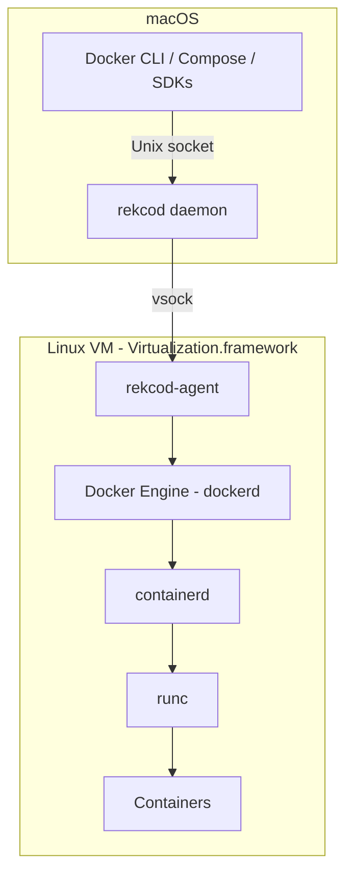
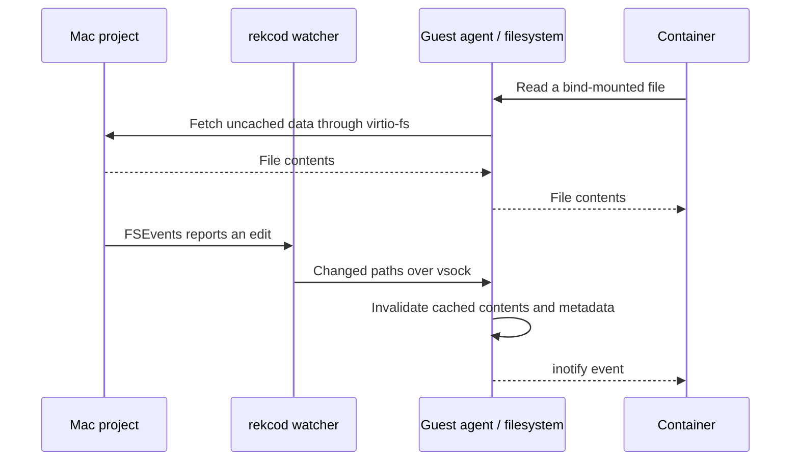
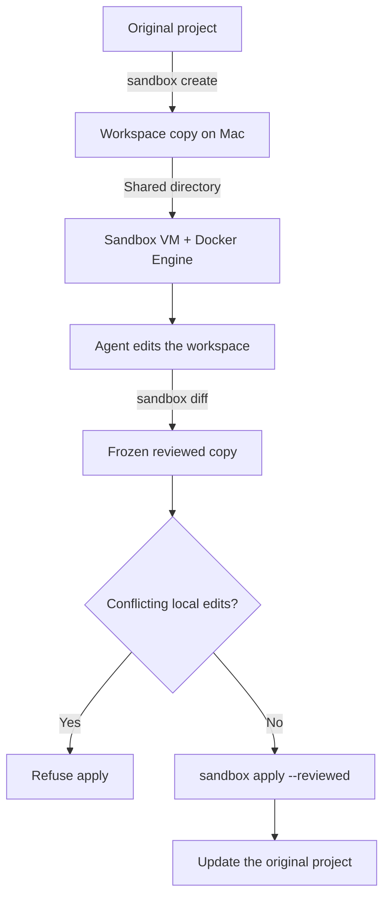
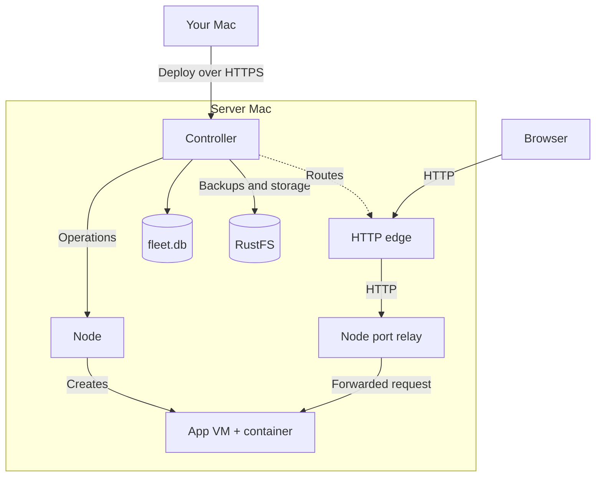
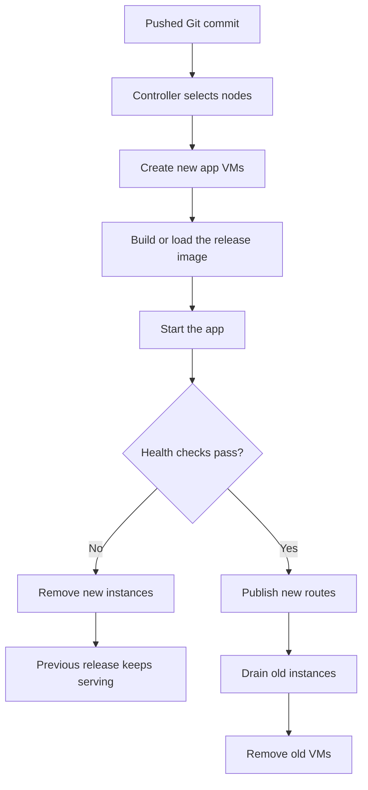

# rekcod

rekcod is an open source Docker Desktop alternative for Apple Silicon Macs. It runs
Docker Engine in a Linux VM and uses your existing Docker commands and Compose files.

## Run your first container

On an Apple Silicon Mac:

```sh
curl -fsSL https://raw.githubusercontent.com/TimMikeladze/rekcod/main/scripts/install.sh | bash
rekcod start
rekcod run --rm hello-world
```

The installer verifies the release checksum. The first start downloads the Linux guest
image and boots Docker Engine inside it. If the `docker` command isn't installed,
rekcod downloads the Docker CLI, Compose and Buildx.

With an existing Docker CLI, `rekcod start` selects the `rekcod` context.
`rekcod stop` powers off the VM and restores your previous context. You can
[copy images and volumes from Docker Desktop or OrbStack](#bring-your-images-and-volumes)
when you're ready.

### Configure the VM

Choose CPU, memory and disk settings when starting a stopped VM:

```sh
rekcod start --cpus 4 --memory 8 --disk 256
```

Memory and disk sizes are in GiB. Settings are saved in `~/.rekcod/config.json`.
The data disk is sparse and can grow, but cannot shrink.

To start the VM now and at login:

```sh
rekcod start --install
```

`rekcod stop` stops the VM's containers, including removing containers created with
`--rm`.

### Bring your images and volumes

To keep existing database data, import before starting your Compose project on rekcod.
Leave the source engine running, with its project containers stopped. Choose the command
for your engine:

```sh
rekcod import --from desktop-linux   # Docker Desktop
rekcod import --from orbstack        # OrbStack
```

Import copies images and named volumes, leaving the originals at the source. Volumes
still in use are skipped. Use `--images-only` or `--volumes-only` to limit the copy.

## Run the project you already have

From your Compose project directory:

```sh
rekcod compose up -d
rekcod compose logs -f
rekcod ps
```

You can also keep using `docker compose up -d` while the rekcod context is active.
Docker commands passed directly to `rekcod` always use its local engine and boot it if
needed.

Published ports appear on the Mac's `localhost`. Edits to bind-mounted source trigger
inotify inside containers.
`host.docker.internal` reaches services on your Mac, and container DNS follows the
Mac's resolvers, including domain-specific VPN resolvers.

rekcod runs the unmodified upstream `dockerd` with its embedded BuildKit. Builds,
Compose and Docker API clients use the engine itself, including buildx workflows.

## Keep dependency writes inside Linux

For installs and build output, you can keep selected directories entirely in the VM.
Add a label to your Compose service:

```yaml
services:
  web:
    build: .
    working_dir: /app
    volumes:
      - .:/app
    labels:
      dev.rekcod.local: "node_modules,.next"
```

rekcod mounts named volumes at those paths when it creates the container. Dependency
installs and build output stay inside Linux, while your source remains editable on the
Mac. The volumes survive container recreation. Their contents are only visible inside
the VM, so Mac tools that need those dependencies need their own installation.

## Restore your database to a known state

Save a Compose project's named volumes after migrating and seeding. You can return to
that state after a test, a broken migration or an experiment:

```sh
rekcod snap save seeded
rekcod snap restore seeded
```

Run these from the Compose project directory. Saving pauses its running containers while
copying the volumes, then unpauses them. Restoring stops the running containers, copies
the saved data back and restarts them.

You can also name snapshots after your current git branch:

```sh
rekcod snap save
rekcod snap ls
```

Before replacing data, a restore saves the current volumes as `pre-restore`.
Run `rekcod snap restore pre-restore` to recover that previous state.
Snapshots live in the VM; `save --push` and `restore --pull` also transfer them through
S3-compatible storage.

## Run project tools without installing them on your Mac

Use the project's Linux toolchain from its directory:

```sh
rekcod x bun install
rekcod x bun run dev
rekcod x uv run pytest
rekcod x cargo test
```

`rekcod x` picks an image from the command and project version files such as
`.bun-version`, `.nvmrc`, `.python-version` and `rust-toolchain.toml`. It mounts the
current directory at the same path and forwards listening ports to the Mac.

Linux dependencies and build output, including `node_modules`, `.venv` and `target`,
stay in VM volumes. Mac and Linux builds of native dependencies stay separate.
Use `--image` to choose an image yourself:

```sh
rekcod x --image alpine:3.24 sh
```

For a command that should only see the current project directory,
`rekcod x --sandbox bun install` runs in a separate VM. It shares that directory
read-write and blocks connections to the Mac and local network.

## Review an agent's changes before applying them

Give a coding agent a copy of your repository in its own VM. It can install packages,
run tests and use Docker there while your original project stays as it was.

For example, from a Bun project:

```sh
sandbox_id=$(rekcod sandbox create)
rekcod sandbox exec "$sandbox_id" -- bun install
rekcod sandbox exec "$sandbox_id" -- bun test
rekcod sandbox diff "$sandbox_id"
```

When you've reviewed the diff, apply that version and remove the sandbox:

```sh
rekcod sandbox apply "$sandbox_id" --reviewed
rekcod sandbox rm "$sandbox_id"
```

`apply --reviewed` writes the workspace version captured by the last `diff`.
It refuses to overwrite files you changed in the original project since they were copied
into the sandbox.

Linux agent sandboxes allow package registries and GitHub by default, with the Mac and
local network blocked. Additional destinations and secrets are explicit options.
Sandbox isolation hasn't had an external security review.

Agents can use the same operations through the `rekcod mcp` stdio server.

## Manage it from the terminal, menu bar or dashboard

```sh
rekcod status
rekcod menubar --install   # open now and start at login
rekcod dashboard           # open the web UI; needs Node.js
rekcod doctor              # check setup and report fixes
rekcod --help
```

The menu bar and dashboard expose the same actions as the CLI: container controls,
logs, snapshots and sandbox changes. The dashboard uses `http://localhost:4500` or the
next free port.

`rekcod status` shows disk use and forwarded ports, including ports another Mac process
already occupies. Use `rekcod start --help` for VM sizing and startup settings.

### Docker SDKs and IDEs

The first `rekcod start` in a terminal may ask for your password to route
`/var/run/docker.sock`, so clients that ignore Docker contexts can connect.
Stopping rekcod restores the previous socket route.

If a shell already sets `DOCKER_HOST`, it overrides Docker contexts.

## Use another Mac as your Docker engine

On the other Mac, enable Remote Login in System Settings and run `rekcod start`.
From your Mac:

```sh
rekcod host add mini me@mac-mini
docker ps
rekcod host forward mini
```

`host add` configures SSH access, creates the `rekcod-mini` Docker context and selects
it. If needed, it asks for the server account's password to install rekcod's SSH key.
`docker ps` now lists containers on the other Mac. Bind mounts refer to paths on that
Mac, so the project files need to be there too.

`host forward` forwards the server's published TCP ports to your Mac's `localhost`
until you press Ctrl-C. Ports already occupied on your Mac are skipped.

```sh
rekcod host ls
rekcod host use local
```

`host use local` selects this Mac's rekcod context again. Commands passed directly to
rekcod, such as `rekcod ps`, always use the local VM regardless of the Docker context.

## Self-host apps on a Mac

Use another Apple Silicon Mac as a deployment target. On that Mac, enable
**Remote Login** under System Settings > General > Sharing. Use an account that can
run `sudo` to install services that start at boot.

For access between networks, connect both Macs to the same Tailscale tailnet. Without
Tailscale, rekcod uses Bonjour discovery on the LAN; both Macs need the same subnet.

From your development Mac:

```sh
rekcod host add mini me@mac-mini --server --domain apps.example.com
rekcod node ls --remote mini
```

This installs rekcod on the server if needed, sets up the controller, worker node,
HTTP edge, RustFS storage and Docker VM, then saves `mini` as a fleet remote and Docker context.
The controller tracks apps and releases, the node runs their VMs, and the edge routes
requests to the app instances.

Setup asks for sudo to install LaunchDaemons and adjust the server's power settings
so it stays awake. Add `--no-power` to leave those settings alone. Without sudo, the
services run as LaunchAgents and require a logged-in session. FileVault still needs
an unlock after an unplanned cold boot.

### Deploy an app

Add `rekcod.toml` to the application's repository:

```toml
[app]
name = "blog"
port = 3000
health = "/healthz"
start = "node server.js" # used only when there is no Dockerfile

[resources]
memory = "1GiB"
idle_stop = "15m"

[env]
NODE_ENV = "production"
```

The application must listen on `0.0.0.0` at `app.port`, and the health path must return
HTTP 200. With a Dockerfile, rekcod builds that file. Without one, `app.start` is
required and rekcod selects a toolchain image from the command and project files.
`idle_stop` stops the app's VMs after inactivity; the next request wakes them.

Commit the configuration and push before deploying. The server must be able to clone
the repository's `origin`; uncommitted changes are not sent.

```sh
git push
rekcod app deploy --remote mini
rekcod app status blog --remote mini
rekcod app logs blog --remote mini
```

Each app instance runs in its own Linux VM. A deployment creates new instances and
checks their health before switching traffic. Instance disks are replaced during
deployments; use an application bucket for persistent files.

The private HTTP edge listens on port `8080` and routes the hostname
`blog.apps.example.com` to this app. Point wildcard DNS for `*.apps.example.com` at
the server's reachable tailnet or LAN address, then open
`http://blog.apps.example.com:8080`.

### Manage releases and configuration

```sh
rekcod app env set blog LOG_LEVEL=debug --remote mini
rekcod app secret set blog API_KEY=your-key --remote mini
rekcod app scale blog 2 --remote mini
rekcod app rollback blog --remote mini
```

Environment and secret changes redeploy the live release. Secrets are encrypted in
the controller database. `scale` changes the number of instances, subject to available
node capacity. `rollback` deploys the previous good release.

To make `mini` the default for fleet commands:

```sh
rekcod remote use mini
```

You can then omit `--remote mini` from app, job and node commands. Fleet remotes and
Docker contexts are separate: `remote use` does not select a Docker engine.

### Make an app public

```sh
rekcod app public blog --remote mini
rekcod app private blog --remote mini
```

Public apps are also served on the server's `127.0.0.1:8081` listener. Configure
Cloudflare Tunnel to route `*.apps.example.com` to `http://127.0.0.1:8081` on the
server. Setup prints the tunnel commands; it does not install `cloudflared` or change
your DNS. Marking an app public alone does not create the tunnel.

Private apps are excluded from that public listener and remain accessible through
the private edge on the configured tailnet or LAN.

### Back up the controller

Server setup configures RustFS for release images, build caches and hourly controller
database backups. You can also create and list backups yourself:

```sh
rekcod controller backup --remote mini
rekcod controller backups --remote mini
```

These backups are stored on the server's RustFS disk. Copy them off the server for
recovery from disk loss. Back up the server's `~/.rekcod/controller/secret-key` separately: it is
needed to decrypt app secrets and is not included in the database backup. Application
buckets need their own backups too.

## Run jobs on the server

From a repository whose current commit has been pushed:

```sh
rekcod job run --remote mini -- bun test
rekcod job ls --remote mini
rekcod job logs JOB_ID --follow --remote mini
```

Each job runs in a new sandbox VM on the fleet. `job run` follows its output by
default; add `--detach` to print the job ID and return. Replace `JOB_ID` with the ID
from `job ls` when reading logs later. `rekcod job cancel JOB_ID --remote mini`
stops a job.

## Run S3-compatible storage

For development on your Mac:

```sh
rekcod storage up
rekcod storage env
rekcod storage down
```

`storage up` runs RustFS in the local VM on an available port and prints its endpoint
and credentials. `storage env` prints them again. `storage down` removes the container
and keeps its data in the `rekcod-storage` volume.

To transfer Compose volume snapshots through that storage:

```sh
rekcod snap save seeded --push
rekcod snap restore seeded --pull
```

To use another S3-compatible store, set `S3_ENDPOINT`, `S3_BUCKET`,
`AWS_ACCESS_KEY_ID` and `AWS_SECRET_ACCESS_KEY` before running the snapshot commands.

For a self-hosted app, add this to its `rekcod.toml` and deploy again:

```toml
[storage]
bucket = true
```

The controller creates a bucket for the app and gives its instances `S3_ENDPOINT`,
`S3_BUCKET`, `AWS_ACCESS_KEY_ID`, `AWS_SECRET_ACCESS_KEY` and `AWS_REGION`.
The credentials are scoped to that bucket. `rekcod app storage blog --remote mini`
shows its connection settings; append `ls` to list its objects.

## Run a self-hosted GitHub Actions runner

The [runner example](examples/github-runner/compose.yaml) runs an arm64 Linux runner
inside the local VM:

```sh
cd examples/github-runner
cp .env.example .env
# Set REPO_URL and ACCESS_TOKEN in .env before starting.
rekcod compose up -d
rekcod compose logs -f
```

Copy [the example workflow](examples/github-runner/workflow/rekcod.yml) into the
target repository's `.github/workflows/` directory. It selects the runner with
`runs-on: [self-hosted, rekcod]`.

Jobs have access to the VM's Docker socket and share its engine with your other
containers. Run trusted workflows only; Docker cleanup commands from a job can also
remove other images, volumes and containers in that VM.

## Upgrade and diagnose problems

```sh
rekcod upgrade --check
rekcod upgrade
rekcod doctor --bundle
```

`upgrade` verifies the release checksum and replaces the installed binary and any
bundled dashboard. A running VM keeps using its current daemon until restarted.
`doctor --bundle` writes a diagnostic archive under `~/.rekcod` with configuration,
status and logs, excluding tokens and keys.

`rekcod uninstall --keep-data` stops the VMs and removes services, socket routing and
Docker context configuration while keeping `~/.rekcod`. Omitting `--keep-data` also
deletes that directory after confirmation.

## How it works

### Docker runs inside a Linux VM



The macOS daemon creates and owns the VM through Apple's Virtualization.framework.
It exposes a Unix socket for Docker clients and forwards requests over vsock, a
communication channel between the Mac and the guest. The guest agent connects that
channel to Docker Engine's `/var/run/docker.sock` inside Linux.

rekcod uses upstream `dockerd`, containerd and runc. Docker Engine handles container
lifecycle, images, networks and builds. rekcod handles the Mac side: VM lifecycle,
file sharing, DNS integration and port forwarding. Keeping the engine upstream means
Docker API behavior comes from Docker itself.

The host proxy recognizes the `dev.rekcod.local` label on container-create requests
and adds the corresponding named-volume mounts. Other requests and the engine's
responses are forwarded; interactive exec and attach connections become byte streams.

Published ports use another vsock channel. The daemon listens on the Mac and the
guest agent connects incoming traffic to the container's published port.
`host.docker.internal` uses a channel in the other direction to reach services bound
to the Mac's loopback address.

The CLI, daemon and menu bar are modes of the same native executable. The menu bar
and optional web dashboard read a shared action catalog and execute CLI commands.
Container operations have one implementation even when they are started from a UI.

### File sharing includes a change-notification path



virtio-fs shares Mac directories with the guest at their Mac paths. Containers bind
mount those paths, so editing the source does not require copying the project into
the main VM.

The guest caches file contents and metadata. A host-side watcher receives macOS
FSEvents and sends changed paths to the guest agent. The patched FUSE module drops
the affected cache entries and emits Linux file-change notifications. When the
watcher reports missed events, rekcod invalidates the affected subtree.

This separates reading shared files from learning that they changed. Dependencies
and build output can instead use named volumes inside Linux, where native libraries
and generated files belong to the guest's toolchain.

### Agent sandboxes have their own workspace and engine



By default, `sandbox create` copies the project into its own workspace and shares
only that copy with a separate VM. The sandbox has its own Docker data disk and
engine. Its containers share that sandbox's Linux kernel; they do not run in the
main Docker VM.

`sandbox diff` freezes the workspace version used for review. `apply --reviewed`
writes from that frozen version, so further agent edits do not change what gets
applied. It checks the original project's files against their state when the
sandbox was created and refuses conflicting changes.

The Mac-side network stack filters sandbox connections, with guest firewall rules
as another layer. Network allowlists and shared directories belong to each sandbox.
Creating one with `--mount` shares the original project directly, so its edits reach
the project immediately.

### Self-hosting separates deployment control from app traffic



The controller stores desired app configuration, releases and node registrations
in SQLite. Nodes create the VMs that build and run app instances. The edge reads the
controller's routing table and forwards HTTP requests to instances through the
nodes' port relays. A request to a sleeping app asks the controller to wake it.

On a single server Mac, the controller, node, edge and RustFS are separate macOS
processes. Additional nodes can run on other Macs. Each app instance gets a separate
Linux VM with its own Docker Engine.

The controller keeps deployment state separate from request handling. The edge
caches its last routing table, while the controller is needed for deployments,
configuration changes and waking sleeping apps. The public listener filters that
table to apps explicitly marked public.

RustFS stores release images, build caches, controller backups and application
buckets. Nodes transfer release images through presigned URLs supplied by the
controller. App instances receive credentials scoped to their own bucket.

### Deployments replace instances after health checks



A deployment records the commit and starts new instances without changing the
current live release. A node builds the image from that commit or loads its stored
release image from RustFS. The controller checks the new instances before making
them live.

If the deployment fails, new instances are removed and the previous release keeps
serving. After success, the controller marks the previous instances as draining
before removing them. Rollback uses the same deployment path with an earlier good
commit.

Replacing whole instances makes their local files disposable. Persistent app files
belong in application buckets; Compose volume snapshots are a separate feature for
the local Docker VM.

### Guest updates and application data use separate files

State lives under `~/.rekcod`:

| Path | Contents | Lifetime |
| --- | --- | --- |
| `vm/root.img` | Linux guest filesystem and Docker binaries | Replaced when the guest version changes |
| `vm/data.img` | Local Docker images, containers and named volumes | Kept across guest updates |
| `sb/<id>/` | A sandbox's workspace, reviewed copy and VM disks | Kept until the sandbox is removed |
| `controller/fleet.db` | Fleet configuration, releases and encrypted secrets | Backed up separately from app data |
| `storage/data/` | Server RustFS objects, including app buckets and controller backups | Kept across app deployments |

Separating the guest root from Docker data lets an upgrade replace the Linux system
without replacing the local engine's images and volumes. Server app instances and
agent sandboxes have their own disks, so their lifecycle is independent of the main
Docker VM. The controller's encryption key is stored outside `fleet.db` and must
accompany a database restore.

[MIT](LICENSE)
