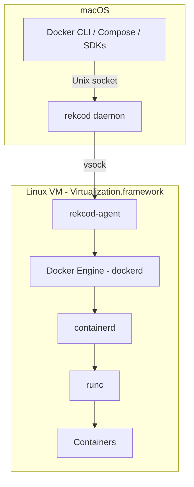
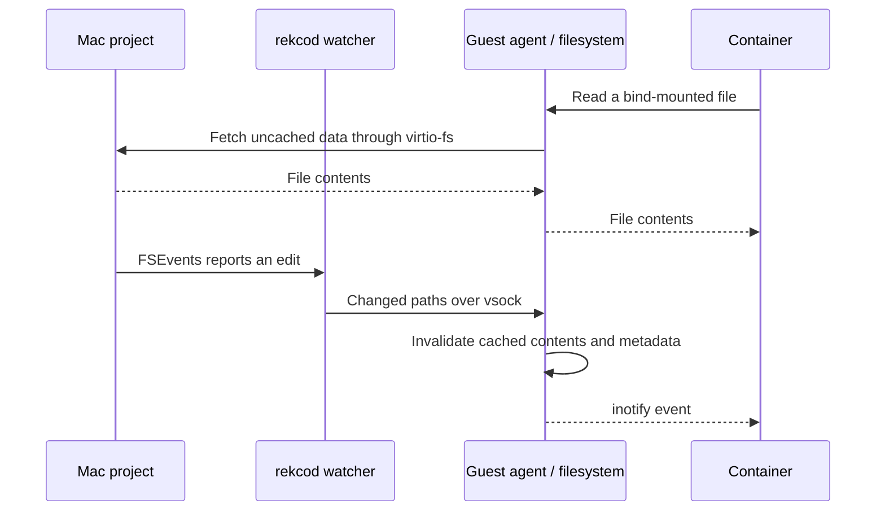
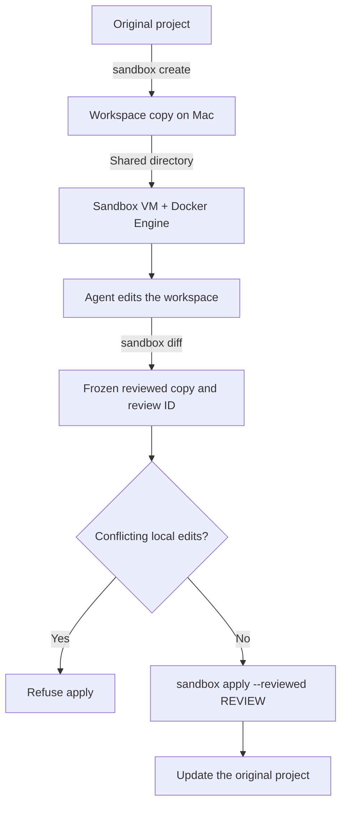
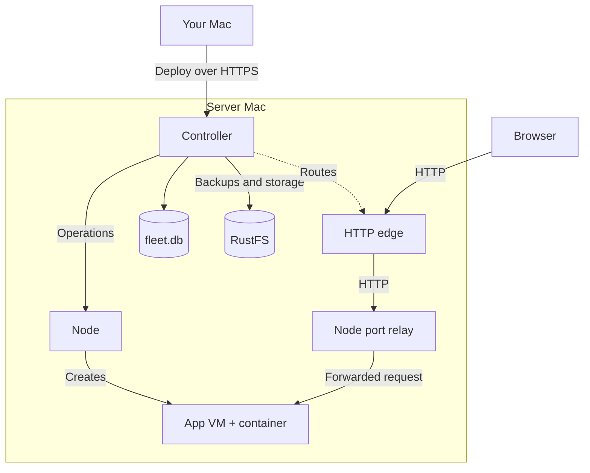
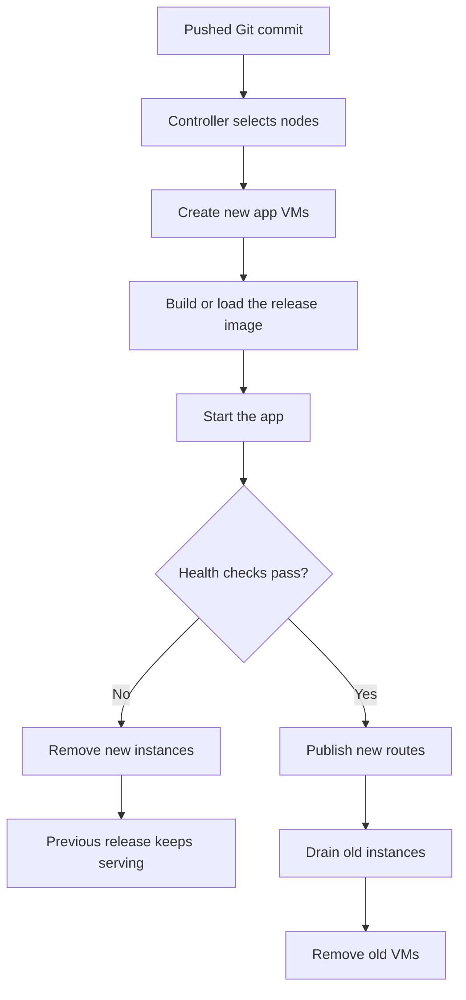

# rekcod

rekcod is an open source Docker Desktop alternative for Apple Silicon Macs. It runs
Docker Engine in a Linux VM and uses your existing Docker commands and Compose files.

## Run your first container

On an Apple Silicon Mac:

```sh
curl -fsSL https://raw.githubusercontent.com/TimMikeladze/rekcod/main/scripts/install.sh | bash
rekcod start
rekcod run --rm hello-world
```

The installer puts `rekcod` in `/usr/local/bin` (`PREFIX=...` for another place) and
installs nothing unless the tarball matches the release's `SHA256SUMS`. With `gh` installed
it also checks the release workflow's build provenance; without it, only the checksum is
checked, and that file comes from the same release as the download. See
[What upgrade verifies](#what-upgrade-verifies). `REKCOD_VERSION=0.3.0` installs that release
instead of the latest.

The first start downloads the Linux guest image and boots Docker Engine inside it. If the
`docker` command isn't installed, rekcod downloads the Docker CLI, Compose and Buildx.

With an existing Docker CLI, `rekcod start` selects the `rekcod` context.
`rekcod stop` powers off the VM and restores your previous context. You can
[copy images and volumes from Docker Desktop or OrbStack](#bring-your-images-and-volumes)
when you're ready.

### Configure the VM

Choose CPU, memory and disk settings when starting a stopped VM:

```sh
rekcod start --cpus 4 --memory 8 --disk 256
```

Memory and disk sizes are in GiB. Settings are saved in `~/.rekcod/config.json`.
The data disk is sparse and can grow, but cannot shrink. `--memory` or `--base-memory` of 0,
more than the Mac's RAM or more than Virtualization.framework allows is refused with the
limit in GiB, and a boot that fails with new settings puts the previous `config.json` back.

On macOS 27, half of `--memory` (at least 4 GiB) is RAM and the rest is swap whose memory
goes back to macOS once the guest frees it; `--base-memory` sets the RAM part. On older macOS
all of it is RAM, held until `rekcod stop`. rekcod doesn't check the macOS version otherwise.

To start the VM now and at login:

```sh
rekcod start --install
```

`rekcod stop` stops the VM's containers, including removing containers created with
`--rm`.

VM disks flush with `fsync`, which a power cut or kernel panic can lose the last writes of.
`REKCOD_DISK_SYNC=full` in `rekcod start`'s environment makes every guest flush a full flush
to the physical disk, at a large cost to databases.

### Bring your images and volumes

To keep existing database data, import before starting your Compose project on rekcod.
Leave the source engine running, with its project containers stopped. Choose the command
for your engine:

```sh
rekcod import --from desktop-linux   # Docker Desktop
rekcod import --from orbstack        # OrbStack
```

Import copies images and named volumes, leaving the originals at the source. Volumes
still in use are skipped. Use `--images-only` or `--volumes-only` to limit the copy.
When an image or volume fails to copy, import exits non-zero and names it. A volume
that failed is incomplete on rekcod, since the copy empties it first; run the import
again before removing the old engine.

## Run the project you already have

From your Compose project directory:

```sh
rekcod compose up -d
rekcod compose logs -f
rekcod ps
```

You can also keep using `docker compose up -d` while the rekcod context is active.
Docker commands passed directly to `rekcod` always use its local engine and boot it if
needed. `rekcod docker ARGS` always goes to docker, for the commands rekcod has a name for
itself (`rekcod docker start web`).

Edits to bind-mounted source trigger inotify inside containers. Container DNS follows the
Mac's resolvers, including domain-specific VPN resolvers. dockerd keeps each container's log
as `json-file`, 10 MB in at most 3 files; containers created before 0.3.0 keep unlimited logs
until they're recreated.

rekcod runs the unmodified upstream `dockerd` with its embedded BuildKit. Builds,
Compose and Docker API clients use the engine itself, including buildx workflows.

### Published ports

Published ports listen on the Mac the way Docker on Linux does:

```sh
docker run -d -p 8080:80 nginx             # every interface: the LAN can reach it
docker run -d -p 127.0.0.1:8080:80 nginx   # this Mac only
```

`rekcod status` shows the first as `*:8080`. A database published with a plain `-p` and a
default password is open to your Wi-Fi network. rekcod never takes a port another Mac
process already has; `rekcod status` lists that port with the error.

`host.docker.internal` reaches services on the Mac, including ones bound to its
`127.0.0.1`. Any container on the main VM can do that, an image you didn't write included.
The dashboard's port is the one exception.

### amd64 images

`linux/amd64` images run through Rosetta:

```sh
docker run --rm --platform linux/amd64 alpine uname -m   # x86_64
```

A Mac that has never run an Intel app may not have Rosetta. The VM then boots without it and
every amd64 container fails with `exec format error`. rekcod doesn't install Rosetta or warn
about it; `~/.rekcod/logs/daemon.log` says `rosetta=false`. Install it and restart the VM:

```sh
softwareupdate --install-rosetta --agree-to-license
rekcod stop && rekcod start
```

## Keep dependency writes inside Linux

For installs and build output, you can keep selected directories entirely in the VM.
Add a label to your Compose service:

```yaml
services:
  web:
    build: .
    working_dir: /app
    volumes:
      - .:/app
    labels:
      dev.rekcod.local: "node_modules,.next"
```

rekcod mounts named volumes at those paths when it creates the container. Dependency
installs and build output stay inside Linux, while your source remains editable on the
Mac. The volumes survive container recreation. Their contents are only visible inside
the VM, so Mac tools that need those dependencies need their own installation.

## Restore your database to a known state

Save a Compose project's named volumes after migrating and seeding. You can return to
that state after a test, a broken migration or an experiment:

```sh
rekcod snap save seeded
rekcod snap restore seeded
```

Run these from the Compose project directory. Saving pauses its running containers while
copying the volumes, then unpauses them. Restoring stops the running containers, copies
the saved data back and restarts them.

You can also name snapshots after your current git branch:

```sh
rekcod snap save
rekcod snap ls
rekcod snap rm seeded
```

Before replacing data, a restore saves the current volumes as `pre-restore`.
Run `rekcod snap restore pre-restore` to recover that previous state. If the restore
copy fails part way (the VM's disk fills up, say), rekcod copies `pre-restore` back
before starting the containers again. If that fails too, the containers stay stopped
and the error prints the command to run once there's room.

Before stopping anything, restore checks that the VM's disk has room for the
`pre-restore` copy and the snapshot, and refuses with the sizes when it doesn't.

Restore refuses while a project container is paused (`docker unpause` it first), and
save refuses while one is restarting. Saves and restores of one project take turns,
whatever the snapshot names, so a menu bar save waits for a terminal restore.

Snapshots live in the VM; `save --push` and `restore --pull` also transfer them through
S3-compatible storage.

### Back up volumes

`~/.rekcod/vm` (every image, container, named volume and snapshot), `~/.rekcod/sb` (agent
sandboxes), `~/.rekcod/golden` and `~/.rekcod/macos/images` are excluded from Time Machine,
since a live disk image copied mid-write isn't usable. A Mac restored from Time Machine, or
set up with Migration Assistant from one, comes back with no volumes and no snapshots. Keep
data you need with `rekcod snap save --push` to storage on another machine, or with your
database's own dumps.

## Run project tools without installing them on your Mac

Use the project's Linux toolchain from its directory:

```sh
rekcod x bun install
rekcod x bun run dev
rekcod x uv run pytest
rekcod x cargo test
```

`rekcod x` picks an image from the command and project version files such as
`.bun-version`, `.nvmrc`, `.python-version` and `rust-toolchain.toml`. It mounts the
current directory at the same path, passes the project's `.env` as environment, and
forwards listening ports to the Mac.

Linux dependencies and build output, including `node_modules`, `.venv` and `target`,
stay in VM volumes. Package caches are shared between projects in `rekcod-x-cache-*`
volumes. Mac and Linux builds of native dependencies stay separate.
Use `--image` to choose an image yourself:

```sh
rekcod x --image alpine:3.24 sh
```

`-p 3000` publishes that port on the Mac's `127.0.0.1` instead of forwarding every
listener; `--no-autoports` forwards nothing.

### Run it in a separate VM

```sh
rekcod x --sandbox bun install
```

`--sandbox` runs the command in a second VM (`~/.rekcod/sandbox`) that shares only the
current directory, read-write, and blocks connections to the Mac and the local network.
Every `.git` under the directory outside dependency directories (a worktree's or submodule's
`.git` file, a nested repository) is read-only inside, so `git commit` there fails. A `.git` the command creates or
replaces is printed afterwards, since git on the Mac runs what a `.git` names, and the run
exits non-zero. `.env` isn't passed as environment; `--secret NAME` passes a variable from
your shell.

One VM serves one directory at a time. A second run in the same directory shares it; a run
for another directory is refused while it's in use. The VM stops after its last run, or
stays up for 30 minutes with `--keep`.

What `--sandbox` doesn't protect:

- The internet is open. There's no allowlist; `--offline` removes the network.
- Ports the command listens on are forwarded to the Mac's `127.0.0.1` and `::1`, unless
  `-p` or `--no-autoports` limits them.
- The command can change any file in the directory, including files the Mac later runs
  (scripts, `package.json`, a Makefile), and it can read `.env`.
- Every project uses the same VM, with one data disk, one image store and the same
  `rekcod-x-cache-*` volumes. One run can leave something in an image or a cache that a later
  run, of another project, executes.

## Review an agent's changes before applying them

Give a coding agent a copy of your repository in its own VM. It can install packages,
run tests and use Docker there while your original project stays as it was.

For example, from a Bun project:

```sh
sandbox_id=$(rekcod sandbox create)
rekcod sandbox exec "$sandbox_id" -- bun install
rekcod sandbox exec "$sandbox_id" -- bun test
rekcod sandbox diff "$sandbox_id"
```

`diff` ends with the line that applies what it showed:

```
rekcod: `rekcod sandbox apply ID --reviewed REVIEW` writes exactly this; without --reviewed it takes the workspace as it is then
```

When you've reviewed the diff, apply that version and remove the sandbox:

```sh
rekcod sandbox apply "$sandbox_id" --reviewed REVIEW
rekcod sandbox rm "$sandbox_id"
```

`apply --reviewed REVIEW` writes the copy that diff froze. Any later diff, yours, the menu
bar's, the dashboard's or an agent's through MCP, replaces the frozen copy, and apply then
refuses with "another diff of sandbox ID replaced it". It also refuses when the project
changed since the review. `apply --check` prints what would change and exits 0 when nothing
would, 1 when something would and 2 on an error.

Apply refuses to overwrite files you changed, added or deleted in the original project since
they were copied into the sandbox.

Agents can use the same operations through the `rekcod mcp` stdio server.

### What diff and apply compare

rekcod renders the diff itself, so the workspace's `.gitattributes` and git config (filters,
textconv, external diff) don't run and don't change it. `git apply` accepts the patch.

- A file with a NUL byte in its first 8000 bytes is shown as `Binary files ... differ`, and
  one over 4 MiB as `rekcod: not shown, over 4 MiB` with both sizes.
- Symlinks are compared by target. Mode changes show all nine permission bits.
- Directories are changes too: new ones keep their mode, deleted ones are removed once
  empty, and a mode change is a conflict if the Mac changed the same directory.
- File names with control characters or bidi controls are escaped (`\u{202e}`).
- `node_modules`, `.venv` and `target` are left out at the project root, and anywhere the
  project already has that directory. A new nested one the agent made is diffed and applied.
  `diff` lists what it didn't compare on stderr.

Apply writes each file to a temporary `.rekcod-PID-N-NAME` beside it, syncs it and renames it
into place. A temp file left by a killed apply is yours to remove. A rename that only changes
case or Unicode normalization applies on case-insensitive APFS.

### Network and secrets

Linux agent sandboxes allow package registries, Docker Hub, GitHub and distro mirrors by
default, with the Mac and local network blocked. Add destinations and pass variables
explicitly:

```sh
rekcod sandbox create --allow-host api.example.com --allow-host db.example.com:5432 --secret OPENAI_API_KEY
```

`*.example.com` allows subdomains and `*` the whole internet. Ports other than 80 and 443
carry only TLS (the SNI is checked) or HTTP (every `Host` is checked). An entry with a port,
`db.example.com:5432`, lets any TCP through to that name's addresses on that port. Port 22
gets the address check only, so `git` over SSH to an allowed host works. Other protocols,
all UDP (QUIC included) and plain-HTTP WebSockets are refused. `--offline` gives the sandbox
no network at all.

`sandbox fork` starts from the parent's disk and workspace, so the fork keeps the parent's
allowlist and the secrets already in its container. `sandbox log ID --net` lists blocked
lookups.

### Let an agent drive sandboxes

```sh
rekcod mcp                                         # MCP on stdio
rekcod sandbox serve                               # HTTP on ~/.rekcod/run/sandbox.sock (0600)
rekcod sandbox serve --listen 127.0.0.1:7800       # also TCP, bearer token in ~/.rekcod/sandbox-token
```

Both create sandboxes only for the directory they started in, unless `--root DIR` adds
others. Everything beyond a plain copy sandbox needs a flag from you:

| Flag | Lets callers |
| --- | --- |
| `--allow-host HOST` | add HOST to a sandbox's allowlist (`*` allows any) |
| `--secret NAME` | pass that variable into a sandbox |
| `--allow-mount` | share the live directory instead of a copy |
| `--allow-macos` | create and use macOS sandboxes, which have no network filter |
| `--allow-apply` | write a sandbox's changes into the project |

Without `--allow-apply`, `apply` with `check: true` works and anything else gets a 403 naming
the flag, and MCP's `tools/list` leaves `sandbox_apply` out. `reviewed` is the review ID a
diff returned, as a string. A sandbox made with more than the flags allow, from the CLI or
another server, isn't listed, and every call on it gets a 403.

The HTTP routes: `POST /sandboxes`, `GET /sandboxes`, `GET` and `DELETE /sandboxes/ID`,
`POST /sandboxes/ID/exec` (NDJSON events, then `{"exit": n}`), `GET` and
`PUT /sandboxes/ID/files?path=` (raw bytes), `POST /sandboxes/ID/fork`,
`GET /sandboxes/ID/diff` (`{changes, patch, review, not_compared}`), `POST /sandboxes/ID/apply`,
`POST /sandboxes/ID/stop`, `GET /sandboxes/ID/logs`, `GET /sandboxes/ID/screenshot` and
`POST /sandboxes/ID/input`.

Request bodies are JSON objects. Flags take JSON booleans or `"true"`/`"false"`, numbers a
JSON number or digits; anything else is a 400. An exec's output stops at 8 MiB per stream,
the command is killed and the reply says `"truncated": true`. Reading a file over 8 MiB is
refused; copy it out with `rekcod sandbox cp`. The API patch is cut at 32 MiB. `rekcod mcp`
writes only JSON-RPC to stdout.

### macOS sandboxes

```sh
rekcod macos fetch
rekcod macos install base
rekcod sandbox create --os macos --image base
```

`macos fetch` downloads Apple's restore image and `macos install` makes a base image from it;
`macos setup` and `macos authorize` finish its setup. A macOS sandbox has plain NAT: it
reaches the internet, the Mac and the LAN, with no allowlist. `sandbox screenshot` and
`sandbox input` drive its screen.

Each base image's SSH host key is pinned in `~/.rekcod/macos/known_hosts.d/IMAGE`, and
`sandbox cp` uses the same pin. `macos install NAME` resets that image's pin. A sandbox whose
key doesn't match fails at boot with the file to delete.

### Clean up sandboxes

```sh
rekcod sandbox ls
rekcod sandbox prune                    # stopped sandboxes unused for 168h
rekcod sandbox prune --older-than 24h
```

`prune` also deletes `~/.rekcod/sb` leftovers a failed create or fork left more than 10
minutes ago; fleet and job sandboxes are skipped. The menu bar and dashboard offer it as
"Remove unused agent sandboxes" with the disk actions. A sandbox powers off after `--ttl`
(30 minutes by default) without an exec; a running exec, shell or open docker connection
(`docker logs -f`, events) keeps it up.

`sandbox create` refuses a project on another volume than `~/.rekcod` (use `--mount`) and an
`--image` that isn't an image reference.

### Sandbox limitations

Sandboxes are defence in depth. They haven't had an external security review.

- The SNI and `Host` checks trust what the client sends. Domain fronting inside TLS to an
  allowed CDN passes, and so does ECH with an allowed outer name.
- On a shared CDN address, a port you allowed for one name is open to every site behind it.
- The default allowlist includes hosts that take uploads with anyone's credentials
  (a gist on github.com, an npm publish, a push to Docker Hub). It limits where code comes
  from more than where data can go.
- Ports a sandbox listens on are forwarded to the Mac's `127.0.0.1` and `::1` only, from
  1024 up, at most 64 per sandbox.
- "Local network" means every subnet the Mac is on and its peer-to-peer links. A subnet
  reached only through a VPN counts as the internet.
- Sandbox DNS answers only plain, one-question queries.
- Copy sandboxes get no file events from the Mac; `--mount` sandboxes get them for the
  project only.

## Manage it from the terminal, menu bar or dashboard

```sh
rekcod status
rekcod menubar --install   # open now and start at login
rekcod dashboard           # open the web UI; needs Node.js
rekcod doctor              # check setup and report fixes
rekcod --help
```

The menu bar and dashboard expose the same actions as the CLI: container controls,
logs, snapshots and sandbox changes. The dashboard uses `http://127.0.0.1:4500` or the
next free port; `localhost` is redirected there.

They also cover what Docker Desktop's images, volumes and networks views do. Each one runs
the docker command shown next to it:

- Images: pull, run with a name, ports, environment and volumes (`run -d`), tag, push,
  show layers, remove
- Containers: start, stop, restart, pause and resume, a shell (`exec -it`), logs, remove
- Volumes: create, list files, clone into a new volume, export to
  `~/Downloads/NAME-YYYYMMDD-HHMMSS.tar.gz` (a new file each time), remove
- Networks: create, remove, prune unused ones
- Disk: remove dangling images, unused anonymous volumes, build cache, unused networks,
  unused agent sandboxes, or everything unused (`system prune`)

Actions that need a value, such as an image to pull, ask for it first. Both front ends
check values before running anything: no leading `-` or control characters, and ports,
`KEY=value` pairs and mounts in docker's format. The menu bar takes repeatable values one per
line and shows the filled-in command before it runs. Commands that need a terminal run in
Terminal from a private script file.

`rekcod status` shows disk use and forwarded ports, including ports another Mac process
already occupies. Use `rekcod start --help` for VM sizing and startup settings.
`rekcod state` prints everything the menu bar and dashboard show, with each item's actions,
as JSON.

### Docker SDKs and IDEs

The first `rekcod start` in a terminal may ask for your password to route
`/var/run/docker.sock`, so clients that ignore Docker contexts can connect.
Stopping rekcod restores the previous socket route.

`rekcod socket install` sets that route up once and installs a root LaunchDaemon,
`dev.rekcod.socket`, that puts it back at every boot. `rekcod socket uninstall` and
`rekcod uninstall` remove both.

If a shell already sets `DOCKER_HOST`, it overrides Docker contexts.

### Dashboard sign-in

Each `rekcod dashboard` launch makes a new token, kept in `~/.rekcod/run/dashboard.json`
(0600). The browser it opens signs in with it and keeps it in that origin's
`localStorage`; there is no cookie. The token keeps out other machines and containers, not
other processes running as you: they can read that file. The dashboard sends a
Content-Security-Policy that keeps scripts and requests on its own origin.

## Use another Mac as your Docker engine

On the other Mac, enable Remote Login in System Settings and run `rekcod start`.
From your Mac:

```sh
rekcod host add mini me@mac-mini
docker ps
rekcod host forward mini
```

`host add` configures SSH access, creates the `rekcod-mini` Docker context and selects
it. If needed, it asks for the server account's password to install rekcod's SSH key.
`docker ps` now lists containers on the other Mac. Bind mounts refer to paths on that
Mac, so the project files need to be there too.

`host forward` forwards the server's published TCP ports to your Mac's `localhost`
until you press Ctrl-C. Ports already occupied on your Mac are skipped.

```sh
rekcod host ls
rekcod host use local
```

`host use local` selects this Mac's rekcod context again. Commands passed directly to
rekcod, such as `rekcod ps`, always use the local VM regardless of the Docker context.

### What `host add` changes

On this Mac:

- When SSH to the other Mac asks for a password, `host add` creates an unencrypted key at
  `~/.rekcod/ssh/id_ed25519` and copies it there with `ssh-copy-id`, which asks for the
  password once in your terminal.
- It adds this block at the top of `~/.ssh/config`, and one `Host` block per host to
  `~/.rekcod/ssh/config`, because docker's own ssh reads nothing else:

  ```
  # >>> rekcod: keys for rekcod hosts (https://github.com/TimMikeladze/rekcod#what-host-add-changes)
  Include "/Users/me/.rekcod/ssh/config"
  # <<< rekcod
  ```

  The first rewrite keeps your previous file as `~/.ssh/config.rekcod-backup`. A symlinked
  config is written through the link. An unreadable config stops `host add`.
- The other Mac's SSH host key is trusted on first connect (`StrictHostKeyChecking=accept-new`).
  For a LAN server found over Bonjour, the key is pinned at `add`; `host use`, `forward`,
  `restart`, `uninstall` and `refresh` follow a Bonjour answer only from a Mac that proves it
  holds that key. A Bonjour answer that isn't a plain host name is ignored.
- DEST must be `[user@]host[:port]` made of letters, digits, `.`, `_` and `-`, not starting
  with `-`.

On the other Mac, it writes a block to `~/.zshenv` between `# >>> rekcod host` and
`# <<< rekcod host` that puts `~/.rekcod/bin` and the docker CLI's directory on `PATH`. When
the only docker CLI there is rekcod's, it also sets `DOCKER_HOST` to rekcod's socket and
`DOCKER_CONFIG` for every shell; otherwise `DOCKER_HOST` is set only for non-interactive SSH
sessions, so that Mac's own terminal keeps its engine. A symlinked `~/.zshenv` is written
through the link. A start line with no end line stops `host add` with a message instead of
editing the file. A login shell other than zsh stops `host add` with the lines to add to that shell's
startup file.

### Manage another Mac's rekcod

```sh
rekcod host exec mini -- ps -a
rekcod host exec mini -- stop
rekcod host state mini
rekcod host refresh mini
rekcod host restart mini
```

`host exec` runs any rekcod command on that Mac over SSH. It asks for a terminal only when
both stdin and stdout are terminals; without one it opens its own SSH connection, and the
remote command stops within about 2 s of the local process being killed. `host state` prints
that Mac's `rekcod state` with every action rewritten to run through `host exec`, and gives
up after 20 s. ssh drops a peer that stops answering after about 10 s.

`host refresh` points a LAN server's context at wherever its Bonjour name answers now.
`host restart` reboots that Mac with one password prompt, through `fdesetup authrestart`
when FileVault is on so the disk unlocks once, and waits until its engine answers again.

The menu bar shows an `Engine: NAME` submenu per host with its VM, containers, images,
volumes, networks, projects, snapshots, sandboxes and storage. In the dashboard, pick the
engine from the menu at the top of the sidebar. The pages then show that Mac's engine; the
fleet pages stay the same. One dashboard shows one engine at a time. Another Mac's state is
checked before use: actions of a kind or with inputs rekcod doesn't know are dropped.

Opening a port, the dashboard and uninstalling aren't offered for another Mac's engine,
and with one selected the dashboard doesn't probe, link or screenshot this Mac.
Use `rekcod host forward NAME` to reach its ports from here.

### Remove a host or server

```sh
rekcod host rm mini
rekcod host uninstall mini
```

`host rm` removes the `rekcod-mini` context and its SSH config block on this Mac only. The
other Mac's `~/.zshenv` block and rekcod's key in its `authorized_keys` stay.

`host uninstall` runs `rekcod uninstall --yes` on the other Mac and stops if that fails.
Then it removes rekcod's key from that Mac's `~/.ssh/authorized_keys`, rewriting the file
only once the filtered copy is complete, and removes the context, SSH config block and
fleet remote `mini` here. A binary installed there by `install.sh`, the pkg or Homebrew
stays, and its path is printed; one `host add` copied to `~/.rekcod/bin` goes with the home.

On a server itself, `rekcod server uninstall` removes the controller, node, edge, storage and
VM services and keeps the data in `~/.rekcod`.

## Self-host apps on a Mac

Use another Apple Silicon Mac as a deployment target. On that Mac, enable
**Remote Login** under System Settings > General > Sharing. Use an account that can
run `sudo` to install services that start at boot.

For access between networks, connect both Macs to the same Tailscale tailnet. Without
Tailscale, rekcod uses Bonjour discovery on the LAN; both Macs need the same subnet.

Server setup uses https. A plain `http://` controller or node URL is accepted only when it
resolves to a loopback or tailnet address (100.64.0.0/10 or fd7a:115c:a1e0::/48), and the
address is checked again before every request, so a `.ts.net` name stops working while
Tailscale is off. `REKCOD_INSECURE=1` allows plain http on a network you trust. Set it for
every command that talks to such an address. Services installed with it set keep it;
services installed by an older rekcod need installing again with it set.

To add a remote or join a node by hand, pass tokens through a file, stdin or the
environment. Tokens on the command line are visible to other accounts on the Mac in the
process list:

```sh
# admin-token is from the controller's ~/.rekcod/controller/; REKCOD_TOKEN also works
rekcod remote add mini https://mini.tail1234.ts.net:7700 --token-file - --ca-fingerprint sha256:... < admin-token
REKCOD_JOIN_TOKEN="$(cat join-token)" rekcod node join https://mini.tail1234.ts.net:7700 --ca-fingerprint sha256:... --install
```

`--token TOKEN` and `node join URL TOKEN` still work. A `node join` without `--install`
keeps serving in the terminal as `rekcod node serve`, without the token in its arguments.
`rekcod remote ls` lists remotes and `rekcod remote rm NAME` forgets one.

From your development Mac:

```sh
rekcod host add mini me@mac-mini --server --domain apps.example.com
rekcod node ls --remote mini
```

This installs rekcod on the server if needed, sets up the controller, worker node,
HTTP edge, RustFS storage and Docker VM, then saves `mini` as a fleet remote and Docker context.
The controller tracks apps and releases, the node runs their VMs, and the edge routes
requests to the app instances.

Setup asks for sudo to install LaunchDaemons and adjust the server's power settings
so it stays awake. Add `--no-power` to leave those settings alone. Without sudo, the
services run as LaunchAgents and require a logged-in session. FileVault still needs
an unlock after an unplanned cold boot.

### What `server setup` installs

`host add --server` runs `rekcod server setup` on the server over SSH; you can also run it
there yourself. It:

- lets rekcod through the macOS application firewall
- with sudo, runs `pmset -a sleep 0 disablesleep 1 autorestart 1 womp 1`, after recording
  the previous values in `~/.rekcod/server/pmset-before.json`, which `rekcod uninstall` puts
  back
- installs `storage`, `controller`, `node`, `edge` and the VM as LaunchDaemons with sudo, or
  as LaunchAgents without
- writes the admin token to `~/.rekcod/controller/admin-token` and the CA fingerprint to
  `~/.rekcod/controller/ca-fingerprint`, and prints the `rekcod remote add` line for your
  other Mac

The services get tokens through their environment, never their arguments.

### Install a server from a pkg

`scripts/package-server.sh` builds `out/server/rekcod-server-VERSION.pkg`. Copy it to the
server and open it there, with nobody's SSH needed:

```sh
scripts/package-server.sh
SERVER_DOMAIN=apps.example.com scripts/package-server.sh
```

The pkg installs `/usr/local/bin/rekcod` and `/usr/local/share/rekcod/{guest,server-domain}`.
It runs `server setup` for the user logged in at the screen, sets `pmset` after recording
the old values, moves the services to LaunchDaemons and leaves the pairing line in
`~/Desktop/rekcod-pair.txt` (0600) and on the clipboard. Delete that file once you've paired:
it holds the admin token. Installing over an earlier install removes its LaunchDaemons first
and makes them again.

The pkg's guest is used only when it's the version the binary was built for; otherwise
rekcod downloads its own. Upgrade a pkg server with `rekcod upgrade`, or `sudo rekcod upgrade`
when `/usr/local/bin` isn't writable for you.

### Restart a server and start it at boot

```sh
rekcod server restart
rekcod server at-boot
```

`server restart` reboots the Mac it runs on with one password prompt, unlocking FileVault for
that boot. `server at-boot` turns a server set up without sudo (LaunchAgents) into
LaunchDaemons that run as the same user and start with nobody logged in; as root, it needs
`--user USER`.

### Deploy an app

Add `rekcod.toml` to the application's repository:

```toml
[app]
name = "blog"
port = 3000
health = "/healthz"
start = "node server.js" # used only when there is no Dockerfile

[resources]
memory = "1GiB"
idle_stop = "15m"

[env]
NODE_ENV = "production"
```

The application must listen on `0.0.0.0` at `app.port`, and a GET of the health path
must answer with a 2xx or 3xx status within 2 s. Redirects aren't followed, so a health
path that redirects to a login page passes. With a Dockerfile, rekcod builds that file.
Without one, `app.start` is required and rekcod selects a toolchain image from the
command and project files.
`idle_stop` stops the app's VMs after inactivity; the next request wakes them.

Inactivity means no new HTTP request through the edge. A sleeping app's VMs are stopped,
so everything in them stops with it: background loops, queue consumers, open WebSockets.
A WebSocket counts as activity only when it opens, and traffic that reaches the app any
other way doesn't count. `rekcod app wake blog --remote mini` starts it without a request.

Commit the configuration and push before deploying. The server must be able to clone
the repository's `origin`; uncommitted changes are not sent. That includes `rekcod.toml`:
`app deploy` sends the one in the commit it deploys and warns when your working copy
differs. With `--ref`, it reads the working copy. For a private repository, give the
server account an SSH deploy key and use an `ssh://` or `git@` origin.

```sh
git push
rekcod app deploy --remote mini
rekcod app status blog --remote mini
rekcod app logs blog --remote mini
```

Each app instance runs in its own Linux VM. A deployment creates new instances and
checks their health before switching traffic. Instance disks are replaced during
deployments; use an application bucket for persistent files.

The private HTTP edge listens on port `8080` and routes the hostname
`blog.apps.example.com` to this app. Point wildcard DNS for `*.apps.example.com` at
the server's reachable tailnet or LAN address, then open
`http://blog.apps.example.com:8080`.

### rekcod.toml settings

`rekcod.toml` is parsed as TOML. An unknown section or key, a value of the wrong type
(`port = "web"`, `public = "true"`) or a memory size that isn't whole GiB fails the deploy,
naming the key and line, on the CLI and on the node.

| Key | Value |
| --- | --- |
| `app.name` | app name (default: the directory's name) |
| `app.port` | port the app listens on (default 3000) |
| `app.health` | path that answers 2xx or 3xx (default `/`) |
| `app.start` | start command when there is no Dockerfile |
| `app.public` | `true` to serve it on the public listener too |
| `resources.instances` | number of instances (default 1) |
| `resources.spread` | `"strict"` puts at most one instance per node or zone; default `"soft"` |
| `resources.cpus` | vCPUs per instance |
| `resources.memory` | `"2GiB"` or `2` (GiB) per instance |
| `resources.idle_stop` | stop the VMs after this long without a request (`"15m"`, `"1d"`) |
| `resources.recycle` | replace the instances with fresh VMs this often |
| `env.NAME` | environment variable; strings, numbers or booleans |
| `storage.bucket` | `true` for an app bucket ([Run S3-compatible storage](#run-s3-compatible-storage)) |
| `http.rate`, `http.burst`, `http.max_body`, `http.timeout` | see [Edge limits and client addresses](#edge-limits-and-client-addresses) |

`cpus`, `memory` and `[env]` keys the file leaves out keep the app's current values.
Durations take `s`, `m`, `h` and `d`.

### Manage releases and configuration

```sh
rekcod app env set blog LOG_LEVEL=debug --remote mini
rekcod app secret set blog API_KEY=your-key --remote mini
rekcod app scale blog 2 --remote mini
rekcod app rollback blog --remote mini
```

Environment and secret changes redeploy the live release. Secrets are encrypted in
the controller database. `scale` changes the number of instances, subject to available
node capacity. `rollback` deploys the previous good release.

Keys set with `app env set` stay across deploys. `app deploy` merges the `[env]` table
of `rekcod.toml` over the app's env, so a key in both takes the value from the file;
`rekcod app env unset blog KEY` removes one, and `rekcod app secret unset blog KEY` a
secret. `[resources]` values the file leaves out keep the app's current ones.

```sh
rekcod app ls --remote mini
rekcod app release blog 3 --remote mini
rekcod app recycle blog --remote mini
rekcod app open blog --remote mini
rekcod app destroy blog --remote mini
```

`app release` shows one release's commit, who deployed it and its deploy log. `app recycle`
replaces the instances with fresh VMs, and `app open` opens the app's URL in a browser.
`app destroy` deletes the app; one with a non-empty bucket needs `--force`.

Deploys of one app run one at a time. While one runs and another waits, a third
(deploy, rollback, scale, env or secret change) is refused with a 409; run it again
once one finishes.

Git URLs with credentials in them are redacted in node logs, in `GET /apps` for viewers
and in `doctor` bundles.

To make `mini` the default for fleet commands:

```sh
rekcod remote use mini
```

You can then omit `--remote mini` from app, job and node commands. Fleet remotes and
Docker contexts are separate: `remote use` does not select a Docker engine.

### Make an app public

```sh
rekcod app public blog --remote mini
rekcod app private blog --remote mini
```

Public apps are also served on the server's `127.0.0.1:8081` listener. Configure
Cloudflare Tunnel to route `*.apps.example.com` to `http://127.0.0.1:8081` on the
server. Setup prints the tunnel commands; it does not install `cloudflared` or change
your DNS. Marking an app public alone does not create the tunnel.

Private apps are excluded from that public listener and remain accessible through
the private edge on the configured tailnet or LAN.

### Deploy pull request previews

Each app has its own GitHub webhook. Print its payload URL and secret:

```sh
rekcod app webhook blog --remote mini
```

In the repository's settings, add a webhook with that payload URL and secret, content
type `application/json`, and the "Pull requests" event. The secret is made the first
time you ask for it and is stored encrypted like app secrets; `--rotate` replaces it,
and the old one stops working. The hook only acts on events for the repository the app
deploys from.

Opening or pushing to a pull request deploys `blog-pr-N` from the PR's head commit,
with the base app's env (not its secrets) and its own empty bucket if the app has one.
Closing the PR destroys it. Previews stay private and sleep after 15 minutes unless the
app sets `idle_stop`; they're removed after a week.

A pull request from a fork runs someone else's code with the app's env and internet
access, so it deploys only when a maintainer adds the `rekcod-preview` label, and only
the head commit at that moment. A later push needs the label again: remove it and add it.
With `GITHUB_TOKEN` set in the controller's environment, rekcod comments the preview URL
on the PR and removes the label after each fork deploy. `GITHUB_API_URL` points it at
GitHub Enterprise (default `https://api.github.com`).

GitHub signs the body of each delivery. An identical body is handled once, and an event
older than one already handled for that PR is ignored, so a replayed `closed` can't
remove a reopened preview. A delivery that failed (no node had room, say) isn't recorded,
so GitHub's Redeliver runs it again.

The controller used to have one webhook secret for every app at `/webhooks/github`. That
route is gone; set each repository's hook up again with `app webhook`.

### Add and remove nodes

Run `rekcod node join` on each Mac that should run app instances, as shown above, with the
controller's join token from `~/.rekcod/controller/join-token` and the fingerprint
`rekcod controller ca` prints on the controller. A new node waits as `pending` and gets no
work until an admin approves it:

```sh
rekcod node ls --remote mini
rekcod node approve NODE_ID --remote mini
rekcod node rm NODE_ID --remote mini
rekcod controller rotate-join --remote mini
```

At most 20 nodes can wait for approval; further joins are refused until some are approved
or removed. A controller started with `--auto-approve` makes new nodes `ready` at once.
`server setup` starts it that way, so on a server set up with `host add --server` anyone
with the join token can add a node that gets deploys, and with them the apps' env and
secrets.

`node rm` forgets a node. Its app instances are replaced on other nodes by the next
reconcile, its sandboxes are marked lost, and its unfinished jobs end as failed with
"whether the job finished is unknown" in their log. `rotate-join` prints a new join token
and writes it to `join-token`; the old one stops working. Nodes that already joined keep
working, since they authenticate with their own secret.

The services run as `rekcod controller serve`, `rekcod node serve`, `rekcod edge serve` and
`rekcod storage serve`, each with `--install` to run as a launchd job. `rekcod node uninstall`,
`rekcod controller uninstall`, `rekcod edge uninstall` and `rekcod storage uninstall` remove
those jobs.

### Take a node out for maintenance

```sh
rekcod node drain NODE_ID --remote mini
rekcod node undrain NODE_ID --remote mini
```

`drain` stops placing work on the node and moves its app instances to other nodes as
capacity allows; instances without anywhere to go keep serving where they are. The
node stays drained through reboots and missed heartbeats until `undrain`.

A node that misses heartbeats for 15 s is `lost`: its app instances leave the routes
and are replaced on other nodes after a minute, and its jobs and user sandboxes are
held. When it heartbeats again, sandboxes it still has run again and ones it no longer
has are removed; deleting a sandbox while its node is away removes the VM once the
node is back. A controller that was itself away (the Mac slept, the process was
stopped) waits 20 s for heartbeats before it marks any node lost.

A job on a lost node isn't started anywhere else. It keeps counting against its owner's
cap and holds its schedule's next run until the node answers again or `node rm` removes
the node.

### Edge limits and client addresses

Server setup installs the edge as `rekcod edge serve --remote edge --listen <addr>:8080
--public-listen 127.0.0.1:8081 --install`. The options that change what it accepts:

```sh
# Peers whose X-Forwarded-For names the client. Default: loopback, where cloudflared runs.
rekcod edge serve --trusted-proxy 10.0.0.5 --trusted-proxy 127.0.0.1
# Read the client address from a header the proxy overwrites, instead of X-Forwarded-For.
rekcod edge serve --client-ip-header cf-connecting-ip
# A TCP load balancer that sends a PROXY v2 header; anyone else is disconnected.
rekcod edge serve --public-listen 0.0.0.0:8081 --proxy-protocol --proxy-protocol-from 10.0.0.2
# Requests per client across all apps (IPv6 counts per /64).
rekcod edge serve --rate 50/s --burst 100
# A line per request: client, method, host and path, status, time.
rekcod edge serve --access-log
```

X-Forwarded-For is read from the right: the first address that isn't a trusted proxy is the
client. CF-Connecting-IP is removed from the request unless `--client-ip-header` names it,
because only Cloudflare overwrites it. Through cloudflared that's fine: Cloudflare appends the
address it saw to X-Forwarded-For, so the rightmost entry is the visitor. The app gets `X-Forwarded-For`, `X-Real-IP`, `X-Forwarded-Host`, `X-Forwarded-Proto`
and `X-Request-Id` from the edge; `Forwarded`, `True-Client-IP`, `X-Client-IP`,
`X-Forwarded-Port` and `X-Forwarded-Server` from the client are removed.

A client over the edge-wide rate gets 429. 100 of those within a minute ban its address (its
/64 for IPv6) on every edge for 10 minutes. An app's own `[http] rate` only answers 429; it
never bans. Bans are managed with `rekcod edge ban`, `unban` and `bans`. An edge token can
only ban an IPv4 /24 or IPv6 /48 or narrower, for at most a day.

Per-app settings go in `rekcod.toml`:

```toml
[http]
rate = "10/s"        # per client, on top of the edge-wide rate
burst = 20
max_body = "20MB"    # 100 MiB by default; larger bodies get 413
timeout = "5m"       # to answer once the request body is in; 60s by default, at most 1h
```

Timeouts and caps:

- A request head has 10 s from its first byte. A request body has to send something every
  30 s or the client gets 408. The response timeout starts when the body is in.
- A connection that moves no bytes for 90 s is closed, also in the middle of a response.
  A server-sent event stream needs a heartbeat more often than that. WebSockets close after
  an hour without traffic.
- An instance takes at most 512 requests at once; with every instance at that, the client
  gets 503 with `Retry-After: 1`.
- One address (an IPv6 /64) may hold 200 connections and 100 WebSockets. The edge raises its
  descriptor limit at start and prints the connection and WebSocket totals it derived from it.
- A request for a sleeping app waits up to 120 s for the wake, then gets 503 with
  `Retry-After`. After a failed wake the app gets 503s for 30 s.
- A GET, HEAD or OPTIONS without a body that fails on a reused instance connection is sent
  once more on a new one. Other failures are a 502 naming the request ID; the instance's
  address and the error are in `~/.rekcod/logs/edge.log`.
- On SIGTERM the edge stops accepting and waits up to 15 s for requests in flight.

Traffic from the edge to the nodes' relays, and both edge listeners, are plain HTTP. Keep the
private listener on a tailnet or LAN.

### Back up the controller

Server setup configures RustFS for release images, build caches and hourly controller
database backups. You can also create and list backups yourself:

```sh
rekcod controller backup --remote mini
rekcod controller backups --remote mini
```

These backups are stored on the server's RustFS disk, so they're lost with it. To keep
a second copy somewhere else, give setup a directory on another disk or a synced folder:

```sh
rekcod server setup --domain apps.example.com --backup-dir /Volumes/Backup/rekcod
rekcod host add mini me@mac-mini --server --domain apps.example.com --backup-dir /Volumes/Backup/rekcod
```

A running controller takes `--backup-dir DIR` too. Each backup goes to RustFS and to
the directory independently; when one fails, the other still gets it and the error
names the one that failed. The copies are `fleet-<UTC time>.db`, mode 0600 in a 0700
directory. Both places keep the newest 48 (two days of hourly backups), then the newest
of each of the last 14 days and 8 weeks.

A backup file is a plain SQLite database. Store it like a secret: a synced folder or a
shared disk gives whoever reads it what's in plain text there:

- each node's secret (`nodes.secret`), the bearer the controller uses on node APIs,
  which create sandboxes and run commands
- the join token, which lets a new node into the fleet
- app env values (not secrets), git URLs, including any credentials written into them,
  and app, release, job and audit history
- token hashes (SHA-256, not the tokens)

App secrets, per-app webhook secrets, app bucket keys and the RustFS root secret are in
it sealed with `controller/secret-key`, so they're readable only with that file. Keep
`secret-key` apart from the backups.

`GET /metrics` has `rekcod_last_backup_timestamp_seconds` (the last successful backup)
and `rekcod_backup_failures_total`, so a Prometheus rule can catch backups that stopped
working. `controller serve --alert-webhook URL` also posts a JSON line
(`{"text": ...}`, which Slack and Discord accept) when a backup fails, a node is lost
or a deploy fails. With `--install`, the URL is kept in `~/.rekcod/controller/alert-webhook`
(0600) instead of the job's plist, and a later `controller serve` uses it; an empty URL
removes it.

The database backup doesn't hold these files from `~/.rekcod` on the server; keep a
copy of each:

| File | Without it |
| --- | --- |
| `controller/secret-key` | App secrets and bucket keys in the backup can't be decrypted |
| `controller/ca.pem`, `controller/ca.key` | Remotes, which pin the CA fingerprint, reject the controller |
| `controller/node-ca.pem`, `controller/node-ca.key` | Nodes' certificates no longer verify |
| `controller/admin-token` | A new admin token is made and the old one stops working |
| `storage/credentials.json` | The RustFS root keys: the controller can't reach the buckets |

The controller makes a CA only when both of its files are missing. With one of a pair
missing or unreadable, or a key that doesn't match its certificate, it refuses to start
and names the file, since a new CA would break every remote, edge and node. Node
certificates last two years; a node asks the controller for a new one in its heartbeat
once its certificate has 90 days left. `rekcod doctor` flags a node or controller
certificate with less than 90 days left (the controller makes its own again at each start),
and the controller posts to `--alert-webhook` once a day while a node's renewal isn't
working.

Application buckets need their own backups too.

### Restore the controller

Stop the controller first; restore refuses while one has the database open. On a
server set up with sudo it's a LaunchDaemon:

```sh
sudo launchctl bootout system/dev.rekcod.controller
rekcod controller restore                    # the newest backup in RustFS
rekcod controller restore fleet-20261118T090000Z.db
rekcod controller restore --from /Volumes/Backup/rekcod/fleet-20261118T090000Z.db
sudo launchctl bootstrap system /Library/LaunchDaemons/dev.rekcod.controller.plist
```

Without sudo the services are LaunchAgents: use `gui/$(id -u)/dev.rekcod.controller`
and `~/Library/LaunchAgents/dev.rekcod.controller.plist` instead. `--from` takes a
`--backup-dir` copy or a file you copied off the server, and needs neither RustFS nor
its keys; use it on a new Mac after copying the files from the table above back into
`~/.rekcod`. The file is copied, not changed.

Restore checks the backup is a whole fleet database before replacing anything. The old
database is kept as `fleet.db.before-restore-<time>`, with the writes its WAL held.
Instances that were running when the backup was taken are marked lost, and the
controller takes back the ones that still answer.

A restore goes back to the time of that backup, up to an hour with the hourly ones:
deploys, tokens, secrets and namespaces changed since are gone. From 10 minutes after the controller starts, nodes delete fleet sandboxes the
database doesn't know, which includes sandboxes created after the backup.

App and webhook secrets in a backup are sealed with a salt per namespace. Deleting a
namespace with `rekcod ns rm` deletes its salt, but backups taken before still have it, so with
`secret-key` they still open that namespace's secrets. Rotate those secrets where they're
issued and delete the older backups from `rekcod-backups` and `--backup-dir`.

### Give people access

The server's admin token is in `~/.rekcod/controller/admin-token`; `host add --server`
saves it in the `mini` remote. Make a token for each person instead of sharing it:

```sh
rekcod controller token alice --remote mini                       # member of default
rekcod controller token ci --ns team --role member --expires 30d --remote mini
rekcod controller token edge1 --edge --remote mini               # for `rekcod edge serve`
rekcod controller tokens --remote mini
```

The token is printed once; the controller keeps only its hash. `controller tokens` lists
each token's name, admin and edge flags, role in `default`, cap, expiry and namespaces.
Names are 1 to 64 letters, digits, `.`, `_`, `@` and `-`. In `default` each person sees
only their own apps, sandboxes and jobs. In other namespaces members share everything:
viewers read, members deploy and run jobs, owners manage members.

```sh
rekcod ns create team --remote mini
rekcod ns member add team alice --role owner --remote mini
rekcod ns member rm team alice --remote mini
rekcod controller limit alice --max-sandboxes 20 --remote mini
rekcod controller revoke alice --remote mini
```

A namespace's quota is set with `ns create` or changed later; each limit is 0 to 100000 or
`unlimited`. `ns use` sends this remote's app, sandbox and job commands to a namespace from
then on, and `ns ls` lists the namespaces you're in with your role, quota and usage:

```sh
rekcod ns quota team --max-cpus 16 --max-memory 64 --max-apps 10 --remote mini   # memory in GiB
rekcod ns use team --remote mini
rekcod ns ls --remote mini
rekcod node pool NODE_ID --ns team --remote mini
rekcod ns rm team --force --remote mini
```

`node pool` dedicates a node to the namespaces named: their work goes only to their pooled
nodes, and other namespaces' work goes only to nodes in no pool. Without `--ns` the node
goes back to everyone. `ns rm` refuses while the namespace has apps, running sandboxes or
unfinished jobs; `--force` destroys the apps and sandboxes and cancels the jobs.

`--max-sandboxes` caps a person's sandboxes plus jobs across namespaces (0 to 100000, or
`unlimited`); app instances count against the namespace quota instead. `revoke` deletes
every token with that name and its memberships, deletes that person's schedules and
cancels their running jobs. `ns member rm` does the same within the namespace. Both print
the sandboxes and apps of theirs that keep running. A schedule also stops running once
its owner's tokens have expired.

```sh
rekcod controller audit --remote mini --since 1d
rekcod controller audit --remote mini --ns team
```

The audit log records deploys, destroys (with whether they worked), env and secret
changes (names only), quota, pool, member, token and schedule changes, requests denied
for a missing role or admin token, and bad tokens (one row per address per minute). Admins
read all of it; a namespace's owners read it with `--ns`. Rows are kept 90 days. When a
namespace is deleted, its rows move to `NAME (deleted TIME)`, so a namespace made later
under the same name doesn't see them, its jobs or their logs.

### What the fleet trusts

The controller (`7700`), nodes (`7701` and a relay port per app instance), the edge
(`8080`) and RustFS (`7710`) are meant for a private network: a tailnet, or a LAN you
trust. Don't forward their ports to the internet. Public traffic comes in through
Cloudflare Tunnel to the edge's `127.0.0.1:8081` listener.

The controller serves https with a CA of its own. `rekcod controller ca`, run on the
controller, prints that CA's fingerprint. `remote add`, `node join` and edge setup with
`--ca-fingerprint` fetch `/ca.pem` once, accept it only if it's a single certificate with
that SHA-256 fingerprint, and from then on trust only that certificate. Node certificates
come from the separate node CA, which only the controller trusts, so a node can never pass
for the controller to a CLI or an edge.

What each credential lets its holder do:

- The admin token does everything, including making tokens, approving nodes and reading
  every namespace.
- A person's token acts in the namespaces it's a member of, with the role it has there.
- An edge token reads the route table for every app, private ones included, reports
  traffic, adds bans and wakes sleeping apps. Nodes let an address that fetched routes
  in the last 10 minutes connect to instance relays directly, so whoever holds an edge
  (or admin) token can reach every app without going through the edge.
- The join token registers nodes. An approved node, or any node on a controller started
  with `--auto-approve`, receives the env and secrets of the apps placed on it.
- An app's webhook secret signs deliveries the controller accepts, which deploy and
  destroy that app's pull request previews.

Traffic between the edge and the nodes' relays is plain HTTP over TCP. A relay accepts
connections only from its own Mac, the controller and the addresses that fetched routes
in the last 10 minutes, which keeps the rest of the network from skipping the edge's
namespace and private-app checks. Anyone on the path between them can still read and
change app traffic, so keep nodes and edges on a tailnet.

A private app is reachable by anyone who can reach the edge's private listener. A LAN
setup (`host add --server --lan`, or no Tailscale) listens on `0.0.0.0:8080`, so every
device on the LAN can open every private app. An app that needs logins has to do them
itself.

A macOS sandbox created on a node has no network filter: it reaches the internet, the
node's Mac and its LAN.

### Fleet limitations

- There is one controller. While it's down there are no deploys, wakes, replacements of
  lost instances, jobs, schedules or webhook deliveries. Edges keep serving from their
  last route table, which they also keep in `~/.rekcod/edge-routes.json` across restarts.
- RustFS is one disk, usually the controller's. Release images, build caches, controller
  backups and app buckets on it aren't replicated; copy them off the server yourself.
- A restore goes back to its backup and deletes newer sandboxes, as described in
  [Back up the controller](#back-up-the-controller).
- A job on a node that stops answering isn't started elsewhere and holds its schedule's
  next run until the node is back or removed.

## Run jobs on the server

From a repository whose current commit has been pushed:

```sh
rekcod job run --remote mini -- bun test
rekcod job ls --remote mini
rekcod job logs JOB_ID --follow --remote mini
```

Each job runs in a new sandbox VM on the fleet. `job run` follows its output by
default; add `--detach` to print the job ID and return. Replace `JOB_ID` with the ID
from `job ls` when reading logs later. `rekcod job cancel JOB_ID --remote mini`
stops a job, and `rekcod job rerun JOB_ID --remote mini` runs its command again.

`job run --name nightly --every 24h -- ./backup.sh` runs it on a schedule instead; the
shortest interval is one minute, and `rekcod job unschedule nightly --remote mini` stops it.
A run that can't start (no node with room, a full quota) shows in `job ls` as a failed job
with the reason, and is tried again after 5 minutes. A job's output on the node stops at
64 MiB; the command keeps running. Job sandboxes open no ports on the node.

## Run S3-compatible storage

For development on your Mac:

```sh
rekcod storage up
rekcod storage env
rekcod storage down
```

`storage up` runs RustFS in the local VM on an available port and prints its endpoint
and credentials. `storage env` prints them again. `storage down` removes the container
and keeps its data in the `rekcod-storage` volume.

To transfer Compose volume snapshots through that storage:

```sh
rekcod snap save seeded --push
rekcod snap restore seeded --pull
```

To use another S3-compatible store, set `S3_ENDPOINT`, `S3_BUCKET`,
`AWS_ACCESS_KEY_ID` and `AWS_SECRET_ACCESS_KEY` before running the snapshot commands,
and `AWS_REGION` when the store checks it (the default is `us-east-1`):

```sh
export S3_ENDPOINT=https://s3.eu-west-1.amazonaws.com AWS_REGION=eu-west-1
export S3_BUCKET=my-snaps AWS_ACCESS_KEY_ID=... AWS_SECRET_ACCESS_KEY=...
rekcod snap save seeded --push
```

`https://` endpoints are checked against the Mac's trusted certificates (`SSL_CERT_FILE`
for a private CA). A plain `http://` endpoint must be on loopback or the tailnet, since
volume archives would cross the network unencrypted; `REKCOD_INSECURE=1` allows one on
a network you trust. Requests are path-style (`https://host/bucket/key`), and each
volume archive is one PUT, so stores that cap a single upload at 5 GiB refuse bigger
volumes.

Two Macs can push the same snapshot. Whichever manifest is written last is what
`--pull` gets; the other push's archives stay in the bucket until a later push is
more than an hour newer.

For a self-hosted app, add this to its `rekcod.toml` and deploy again:

```toml
[storage]
bucket = true
```

The controller creates a bucket for the app and gives its instances `S3_ENDPOINT`,
`S3_BUCKET`, `AWS_ACCESS_KEY_ID`, `AWS_SECRET_ACCESS_KEY` and `AWS_REGION`.
The credentials are scoped to that bucket. `rekcod app storage blog --remote mini`
shows its connection settings; `rekcod app storage blog ls --remote mini` lists its objects.

```sh
rekcod app storage blog url reports/march.pdf --expires 24h --remote mini
rekcod app storage blog rotate --remote mini
```

`url` prints a presigned GET URL, signed with the app's own key, for at most 7 days.
`rotate` gives the app a new key and redeploys the live release with it. The old key
keeps working until the new release is live and the old instances have drained, then
it's revoked, along with URLs signed with it. If the redeploy fails, the app keeps the
old key. A destroy revokes the key and deletes the bucket, every object version in it
included. The instances go before `app destroy` returns; the bucket and stored images
are deleted after, in the background. Until that's done `rekcod app status NAME`
shows `destroying` and, if a delete failed, the error; the controller retries every
minute, and the name stays taken until it works.

`rekcod doctor` on the server checks that the firewall lets RustFS through when it
listens beyond loopback; other Macs' connections would otherwise be accepted and stall.

On a LAN server (`--lan`, or `--addr` with an address outside the tailnet) RustFS
listens on the server's loopback, because it speaks plain HTTP. Bucket apps then run
only on the server Mac's own node, and nodes on other Macs build each release from git
instead of loading it from RustFS. On a tailnet, RustFS listens on the tailnet address
and every node can reach it.

A server set up with `--addr` on a LAN address before this rule had RustFS on that
address; `storage serve` and the controller now refuse to start with it. Run
`rekcod server setup` again with the same options to move RustFS to loopback, then
redeploy bucket apps so their instances get the new `S3_ENDPOINT`. `REKCOD_INSECURE=1`
in both services' environment keeps the old layout.

## Run a self-hosted GitHub Actions runner

The [runner example](examples/github-runner/compose.yaml) runs an arm64 Linux runner
inside the local VM:

```sh
cd examples/github-runner
cp .env.example .env
# Set REPO_URL and ACCESS_TOKEN in .env before starting.
rekcod compose up -d
rekcod compose logs -f
```

Copy [the example workflow](examples/github-runner/workflow/rekcod.yml) into the
target repository's `.github/workflows/` directory. It selects the runner with
`runs-on: [self-hosted, rekcod]`.

`ACCESS_TOKEN` should be a fine-grained token for that one repository with only
"Administration: read and write". Every job can read it.

Jobs have access to the VM's Docker socket and share its engine with your other
containers. Through it a job can start a container with any Mac folder the VM shares and
reach services on the Mac's loopback. Run trusted workflows only, and don't attach the
runner to a public repository: a pull request from a fork could run code on your Mac.
Docker cleanup commands from a job can also remove other images, volumes and containers in
that VM. To keep the runner off your own engine, run it in a VM of its own with a separate
`REKCOD_HOME`.

## Upgrade, roll back and uninstall

```sh
rekcod upgrade --check
rekcod upgrade
rekcod upgrade --rollback
```

`upgrade --check` exits 0 when this is the latest release, 1 when a newer one exists and 2
when it couldn't tell. `upgrade` replaces the installed binary and any bundled dashboard, and
keeps the replaced binary as `.rekcod.previous` beside it. A running VM keeps using its
current daemon until `rekcod stop && rekcod start`. A Homebrew install upgrades with
`brew upgrade rekcod`; one in a directory you can't write needs `sudo rekcod upgrade`.

On a server, `upgrade` then restarts the controller, node, edge and storage services
that run that binary, in that order, and waits for the controller to listen again
before the rest. A controller accepts heartbeats and route fetches from nodes and edges
one minor version behind it, so with several Macs, upgrade the controller's Mac first.
CLIs must be on the controller's minor version; an older one gets "this controller
runs rekcod X, you have Y".

Downloads from GitHub are https only, redirects included. A download gives up after 15 s
without a connection or 60 s below 1 KiB/s (`install.sh`: 30 s) and is retried 3 times; there's no cap on the
whole download. The guest, Docker CLI and RustFS downloads work the same way.

Breaking changes between releases and how to move over are in [CHANGELOG.md](CHANGELOG.md).

### What upgrade verifies

`install.sh` and `rekcod upgrade` check the same things, in order:

1. The tarball matches the release's `SHA256SUMS`. That file comes from the same release as
   the download, so on its own it only catches a damaged download.
2. With `gh` installed, `gh attestation verify` checks the tarball's build provenance from
   this repository's `release.yml`, using the release's `rekcod.sigstore.json` and falling
   back to GitHub's API when that file doesn't load. A failed check installs nothing. When
   `gh` can't check (not logged in, offline) it says so and goes on. Under sudo, gh runs as
   `SUDO_USER`.
3. When the installed rekcod is signed with a Developer ID, the new one must be signed by the
   same team.

When neither of the last two ran, both print `only the checksum was checked, and it comes
from the same release as the download`. To check a download by hand:

```sh
shasum -a 256 -c SHA256SUMS --ignore-missing
gh attestation verify rekcod-darwin-arm64.tar.gz -R TimMikeladze/rekcod
```

Releases are ad-hoc signed until the Developer ID secrets are set up, and not notarized.
Releases before 0.3.0 have no `rekcod.sigstore.json`.

### Roll back

`rekcod upgrade --rollback` swaps `.rekcod.previous` back in and restarts the fleet services
on it; a second rollback goes forward again. The menu bar and dashboard offer it as "Go back
to the previous version" while that file exists. The dashboard directory isn't rolled back.

Before a new rekcod migrates `fleet.db`, it copies it to `fleet.db.before-schema-N`. An older
rekcod refuses a database a newer one migrated. To go back a release on a controller, stop
the controller, put that copy back as `fleet.db`, and install the older version:

```sh
curl -fsSL https://raw.githubusercontent.com/TimMikeladze/rekcod/main/scripts/install.sh | REKCOD_VERSION=0.3.0 bash
```

### Uninstall

```sh
rekcod uninstall --keep-data
rekcod uninstall
```

Both stop the VM and agent sandboxes, remove rekcod's launchd jobs, the socket route and the
`rekcod` Docker context, remove the `~/.zshenv` block and firewall exceptions, and put `pmset`
back from `~/.rekcod/server/pmset-before.json` (only lines that run `pmset` are replayed, as
`/usr/bin/pmset`). `--keep-data` keeps `~/.rekcod`, the sandboxes' workspaces, reviewed
copies and disks included. Without it, uninstall also removes the contexts `host add` made
and the `~/.ssh/config` Include, and deletes `~/.rekcod` after you type `yes`. The prompt
names the directory.

- It asks for sudo first when LaunchDaemons are installed. Where sudo can't ask (no
  terminal), it stops with nothing changed.
- When stopping the VM, a sandbox step or removing a job fails, it keeps the home and the
  Include, prints `FAIL` for each failed step and `kept` for what it held back, and exits
  non-zero. `host uninstall` relies on that.
- It deletes a home rekcod created, or one holding only rekcod's own entries. A directory
  with other files is refused, and the error lists them.
- Under another `REKCOD_HOME`, it removes only that home's VM, sandboxes, jobs whose plist
  names that home, and the directory. The Docker context, `~/.zshenv`, firewall, `pmset` and
  the Include belong to `~/.rekcod`'s install and stay.

At the end it prints what it left: the binary, the server pkg's files with the command that
removes them, and `~/Desktop/rekcod-pair.txt`, which holds an old admin token.

### Services that start at login

`--install` (on `start`, `menubar`, `dashboard` and the fleet `serve` commands) writes a
launchd job named `dev.rekcod.NAME`.

- `REKCOD_HOME` must be absolute; an empty or relative one is an error.
- `--install` refuses a job of the same name another `REKCOD_HOME` installed.
- launchd starts jobs in `/`, so `--install` makes relative `--db`, `--data`, `--backup-dir`
  and `--storage-credentials` paths absolute.
- These variables are copied into the job when they're set: `REKCOD_INSECURE`,
  `REKCOD_GUEST_DIR`, `REKCOD_NS`, `REKCOD_DEBUG`, `REKCOD_KERNEL_CMDLINE`,
  `REKCOD_DISK_SYNC`, `REKCOD_BALLOON`, `REKCOD_NO_BALLOON`, `REKCOD_DOCKER_CLI`,
  `REKCOD_DASHBOARD_DIR`, `REKCOD_SYSTEM_SOCKET`, `REKCOD_NODE`, `DOCKER_CONFIG`,
  `S3_ENDPOINT` and `S3_BUCKET`. `AWS_ACCESS_KEY_ID`, `AWS_SECRET_ACCESS_KEY` and
  `GITHUB_TOKEN` are never written into a plist; `--install` says which it left out.
- A job that exits right after it's loaded is reported, with its log.
- A Homebrew install's jobs, menu bar item and firewall exception use `PREFIX/bin/rekcod`,
  not the Cellar path, so they survive `brew upgrade`.

## When something breaks

Start with `rekcod doctor`. It prints one line per check and a fix for each that fails, and
exits 1 when one fails:

```sh
rekcod doctor
rekcod doctor --json     # {"ok": bool, "checks": [{"name", "ok", "detail", "fix"}]}
rekcod doctor --bundle   # ~/.rekcod/doctor-<time>.tar.gz to attach to an issue
```

It checks the VM, dockerd, the daemon's and guest's versions against this binary's, free
disk, the data disk, file modes, the Docker context, `DOCKER_HOST`, the socket route, fleet
certificates and sandbox leftovers. "VM reaches the internet" runs only when `alpine:3.24`
is already there (doctor doesn't pull) and gives up after 30 s. `/var/run/docker.sock` not
being routed fails only when a route `socket install` set up is gone. The bundle has
configuration, status and logs, with tokens, keys and credentials in URLs left out.

Logs are in `~/.rekcod/logs`: `daemon.log` (the Mac side), `console.log` (the guest's kernel
and boot), plus `controller.log`, `node.log`, `edge.log`, `storage.log`, `dashboard.log`
and `menubar.log` for whichever runs. Each boot starts a fresh `daemon.log` and
`console.log`, keeping the previous one as `.1`. A log that passes 20 MB is moved to `.1` and
started again, checked every minute for `daemon.log` and every hour for the others.
`rekcod shell` opens a root shell in the VM.

### The VM won't start

- `the VM's data disk can't be used: ...`: nothing was formatted. `rekcod stop`, then
  `rekcod start --repair` runs `e2fsck -fy` on the data disk (trying its backup
  superblocks) and reinstalls the root disk. It waits up to 30 minutes, and the time e2fsck
  takes doesn't count against the usual boot wait.
- `--repair` fails too: copy `~/.rekcod/vm/data.img` somewhere else if anything on it
  matters, then move it out of `vm/`. The next `rekcod start` creates an empty disk.
- `dockerd did not answer within 120s`: the end of `~/.rekcod/logs/console.log` usually says
  why.
- `another rekcod daemon is running for ...`: one is, for that `REKCOD_HOME`.
  `rekcod stop --force` powers off a hung VM; a daemon still there 45 s later gets SIGKILL.

### Containers can't reach the internet

DNS working while connections time out is usually a VPN or firewall app blocking
Virtualization.framework's NAT (Mullvad does with its defaults). `rekcod start --network user`
makes rekcod open the VM's connections itself, from the Mac, so the VPN carries them like any
app's. `--network auto`, the default, does that when the Mac's default route goes through a
tunnel at boot; a VPN connected later needs `rekcod stop && rekcod start`.

### Other fixes

- `rekcod compact` gives unused data-disk space back to macOS now; it also runs hourly.
- `rekcod doctor` says the state isn't private: a `sudo rekcod ...` left files owned by root.
  `sudo chown -R "$(whoami)" ~/.rekcod`, and the next rekcod command sets the modes again.
- A macOS sandbox that fails with a host key mismatch names the `known_hosts.d` file to
  delete.

## Command reference

`rekcod COMMAND --help` prints each command's options. Anything not in this list runs as
`docker COMMAND` against rekcod.

| Command | What it does |
| --- | --- |
| `rekcod start` | Boot the VM and make `rekcod` the active docker context |
| `rekcod stop` | Power off the VM and restore the previous docker context |
| `rekcod status` | Show VM state, versions, forwarded ports, disk and file-cache stats |
| `rekcod snap save` | Snapshot the project's volumes (NAME defaults to the git branch) |
| `rekcod snap restore` | Put the project's volumes back to a snapshot |
| `rekcod snap ls` | List snapshots |
| `rekcod snap rm` | Delete a snapshot |
| `rekcod x` | Run a command in a container, no Dockerfile: `rekcod x npm run dev` |
| `rekcod sandbox create` | Create a sandbox for DIR (default: this directory) and print its ID |
| `rekcod sandbox exec` | Run a command in the sandbox; exits with its exit code |
| `rekcod sandbox shell` | Interactive shell in the sandbox |
| `rekcod sandbox cp` | Copy files; one side is ID:/path |
| `rekcod sandbox fork` | New sandbox from this one's disk and workspace (processes don't carry over) |
| `rekcod sandbox diff` | Workspace changes against the real project |
| `rekcod sandbox apply` | Write the workspace's changes into the real project |
| `rekcod sandbox screenshot` | Save a macOS sandbox's screen as PNG |
| `rekcod sandbox input` | Mouse and keyboard for a macOS sandbox: click X Y \| type TEXT \| key [cmd+]KEY |
| `rekcod sandbox ports` | Forwarded ports and VM status |
| `rekcod sandbox log` | Commands run in the sandbox (`--net`: blocked lookups) |
| `rekcod sandbox ls` | List sandboxes |
| `rekcod sandbox stop` | Power off, keeping state; the next exec boots it again |
| `rekcod sandbox rm` | Force stop and delete |
| `rekcod sandbox prune` | Delete stopped sandboxes not used for a while, and what failed creates left behind |
| `rekcod sandbox serve` | Serve the sandbox API on ~/.rekcod/run/sandbox.sock |
| `rekcod sandbox golden build` | Build (or rebuild) a golden disk |
| `rekcod sandbox golden ls` | Golden disks |
| `rekcod sandbox golden rm` | Delete a golden disk |
| `rekcod mcp` | MCP server on stdio exposing the sandbox commands to agents |
| `rekcod upgrade` | Install the latest release over this binary and restart the fleet services that run it (the VM keeps running the old one until restarted) |
| `rekcod uninstall` | Stop rekcod and remove everything it set up: launchd jobs, the socket route, the docker contexts, the ~/.zshenv block, firewall exceptions, pmset (as `server setup` found it), and ~/.rekcod |
| `rekcod doctor` | Check what usually goes wrong and say how to fix it |
| `rekcod macos fetch` | Download the newest macOS restore image this Mac supports (resumable) |
| `rekcod macos install` | Install the restore image into a new base image |
| `rekcod macos setup` | Open the image's screen to finish setup by hand (Setup Assistant, Remote Login) |
| `rekcod macos authorize` | Install rekcod's SSH key in the running image (asks for the guest password) |
| `rekcod macos ls` | Base images |
| `rekcod macos rm` | Delete a base image |
| `rekcod remote add` | Add a controller; the first one added is the default |
| `rekcod remote ls` | Remotes; * marks the default |
| `rekcod remote rm` | Forget a remote |
| `rekcod remote use` | Make NAME the default remote |
| `rekcod host add` | Set up DEST (user@mac) for docker over SSH and switch the docker context to it |
| `rekcod host ls` | Hosts (docker contexts rekcod-*); * marks the one in use |
| `rekcod host use` | Switch the docker context to a host, or `local` for this Mac's rekcod |
| `rekcod host state` | That Mac's `rekcod state` as JSON, each action rewritten to run from here (the dashboard and menu bar manage a host's engine with it) |
| `rekcod host exec` | Run `rekcod ARGS` on that Mac: `rekcod host exec mini -- ps -a` |
| `rekcod host rm` | Delete a host's docker context |
| `rekcod host forward` | Forward the host's published ports to 127.0.0.1 here until Ctrl-C (default: all, followed live) |
| `rekcod host refresh` | Point a LAN server's docker context at its current address, found over Bonjour (default: every such host) |
| `rekcod host restart` | Restart a server so it comes back on its own (FileVault unlocked for that one boot), then wait until it's back |
| `rekcod host uninstall` | Remove rekcod from that Mac entirely (`rekcod uninstall` there, rekcod's SSH key), then its docker context, SSH config and remote NAME here |
| `rekcod server setup` | Controller, node, edge, RustFS and the VM as LaunchDaemons (LaunchAgents without sudo); no sleep with the lid shut |
| `rekcod server uninstall` | Remove the controller, node, edge, RustFS and VM jobs (data stays) |
| `rekcod server restart` | Restart this Mac so it comes back on its own: with FileVault on, unlocks the disk for that one boot (`fdesetup authrestart`) |
| `rekcod server at-boot` | Make a server set up without sudo start at boot, nobody logged in: its LaunchAgents become LaunchDaemons that run as the same user (asks for sudo) |
| `rekcod node join` | Register with a controller and start serving (saves ~/.rekcod/node.json) |
| `rekcod node serve` | Serve again after a restart (uses ~/.rekcod/node.json) |
| `rekcod node uninstall` | Remove the node's LaunchAgent |
| `rekcod node ls` | Nodes known to the controller (admin token) |
| `rekcod node drain` | Stop new placements and move app replicas after their replacements are healthy |
| `rekcod node approve` | Let a node that joined take work (admin token) |
| `rekcod node rm` | Forget a node; its app instances move to other nodes (admin token) |
| `rekcod node undrain` | Place sandboxes on a drained node again (admin token) |
| `rekcod node pool` | Dedicate a node to namespaces (admin token); no --ns gives it back to everyone |
| `rekcod controller serve` | Run the controller |
| `rekcod controller uninstall` | Remove the controller's LaunchAgent |
| `rekcod controller backup` | Upload fleet.db to rekcod-backups now (it also does every hour); admin token |
| `rekcod controller backups` | Backups in rekcod-backups |
| `rekcod controller restore` | Replace fleet.db with a backup (the latest in RustFS unless KEY, or --from FILE); stop the controller first |
| `rekcod controller limit` | Change an existing token's cap (admin token); applies to every token with that name |
| `rekcod controller token` | Create a user token (admin token) |
| `rekcod controller tokens` | Every token: name, role, cap, expiry and namespaces, never the token itself (admin token) |
| `rekcod controller audit` | Who did what, newest first: admins see everything, a namespace's owners see it with --ns |
| `rekcod controller revoke` | Delete every token with this name (admin token) |
| `rekcod controller ca` | This controller's CA fingerprint, for `remote add` and `node join` (run on the controller) |
| `rekcod controller rotate-join` | Make a new join token; the old one stops working (admin token) |
| `rekcod edge serve` | Serve HTTP ingress (needs a remote with an edge or admin token) |
| `rekcod edge uninstall` | Remove the edge's LaunchAgent |
| `rekcod edge ban` | Ban an IP or CIDR range on every edge (asks for one when left out) |
| `rekcod edge unban` | Lift a ban on every edge |
| `rekcod edge bans` | Banned addresses, with reason and expiry |
| `rekcod storage serve` | Run RustFS on this Mac for the fleet (downloads the pinned release on first run) |
| `rekcod storage uninstall` | Remove its LaunchAgent (the data stays) |
| `rekcod storage up` | RustFS in the local VM on a free port (from 9000); prints the env block |
| `rekcod storage down` | Stop the local one (the data stays in volume rekcod-storage) |
| `rekcod storage env` | The local one's env block |
| `rekcod app deploy` | Deploy this repository's pushed HEAD (settings from rekcod.toml, flags win) |
| `rekcod app ls` | Apps and their state |
| `rekcod app wake` | Start a sleeping app's instances now |
| `rekcod app recycle` | Replace the instances with fresh VMs (a zero-downtime redeploy of the live commit) |
| `rekcod app webhook` | The app's GitHub webhook: the payload URL and secret for the repository's settings (pull request events deploy previews) |
| `rekcod app public` | Serve an app on the edge's public listener |
| `rekcod app private` | Take an app off the public listener (it stays on the private one) |
| `rekcod app status` | Releases, instances, env and URL |
| `rekcod app rollback` | Go back to an earlier good release (default: the one before the live one) |
| `rekcod app scale` | Set the number of instances |
| `rekcod app env set` | KEY=VALUE...; redeploys the live release |
| `rekcod app env unset` | KEY...; redeploys the live release |
| `rekcod app secret set` | KEY=VALUE...; redeploys the live release |
| `rekcod app secret unset` | KEY...; redeploys the live release |
| `rekcod app logs` | The app's logs |
| `rekcod app release` | One release: commit, who deployed it, when it finished, and its deploy log |
| `rekcod app open` | Open the app's URL in a browser and print it |
| `rekcod app destroy` | Delete the app; a non-empty bucket needs --force (asked for on a terminal) |
| `rekcod app storage` | The app's bucket: endpoint, key and size; `ls`, `url KEY`, `rotate` |
| `rekcod app storage ls` | Objects in the bucket |
| `rekcod app storage url` | A presigned GET URL for KEY |
| `rekcod app storage rotate` | New key for the app's bucket; redeploys the live release with it, then revokes the old key |
| `rekcod job run` | Run CMD in a new sandbox on the fleet, from this repo's pushed HEAD |
| `rekcod job ls` | Recent jobs and schedules |
| `rekcod job logs` | A job's output (the last 64 KiB once it's finished) |
| `rekcod job rerun` | Run a finished job's command again (same repo, commit and settings) as a new job |
| `rekcod job cancel` | Stop a job |
| `rekcod job unschedule` | Delete a schedule (its running job keeps going) |
| `rekcod ns create` | Create a namespace (admin token) |
| `rekcod ns ls` | Namespaces you're in, with your role, quota and usage |
| `rekcod ns quota` | Change a namespace's quota (admin token) |
| `rekcod ns member add` | Add a token name to a namespace with a role |
| `rekcod ns member rm` | Take a token name out of a namespace; stops their schedules and running jobs there |
| `rekcod ns use` | Send this remote's app, sandbox and job commands to NAME from now on |
| `rekcod ns rm` | Delete a namespace (admin token); --force destroys its apps, sandboxes and jobs |
| `rekcod import` | Copy images and named volumes from another docker context (desktop-linux, orbstack, ...) |
| `rekcod shell` | Open a root shell in the VM |
| `rekcod compact` | Give unused data-disk space back to macOS now (also runs hourly) |
| `rekcod socket install` | Point /var/run/docker.sock at ~/.rekcod/default.sock (sudo, once), and again at every boot (a root LaunchDaemon); start/stop then switch it |
| `rekcod socket uninstall` | Put /var/run/docker.sock back to what it was before `install` and remove the LaunchDaemon (sudo) |
| `rekcod menubar` | Menu bar item: status, start/stop, forwarded ports |
| `rekcod state` | Everything the menu bar and dashboard show, with each item's actions, as JSON |
| `rekcod dashboard` | The web dashboard: start it (or find the running one) and open it |

## How it works

### Docker runs inside a Linux VM



The macOS daemon creates and owns the VM through Apple's Virtualization.framework.
It exposes a Unix socket for Docker clients and forwards requests over vsock, a
communication channel between the Mac and the guest. The guest agent connects that
channel to Docker Engine's `/var/run/docker.sock` inside Linux, and takes vsock
connections from the Mac only.

rekcod uses upstream `dockerd`, containerd and runc. Docker Engine handles container
lifecycle, images, networks and builds. rekcod handles the Mac side: VM lifecycle,
file sharing, DNS integration and port forwarding. Keeping the engine upstream means
Docker API behavior comes from Docker itself.

The host proxy recognizes the `dev.rekcod.local` label on container-create requests
and adds the corresponding named-volume mounts. Other requests and the engine's
responses are forwarded; interactive exec and attach connections become byte streams.

Published ports use another vsock channel. The daemon listens on the Mac and the
guest agent connects incoming traffic to the container's published port.
`host.docker.internal` uses a channel in the other direction to reach services bound
to the Mac's loopback address.

The CLI, daemon and menu bar are modes of the same native executable. The menu bar
and optional web dashboard read a shared action catalog and execute CLI commands.
Container operations have one implementation even when they are started from a UI.

### File sharing includes a change-notification path



virtio-fs shares Mac directories with the guest at their Mac paths. Containers bind
mount those paths, so editing the source does not require copying the project into
the main VM.

The guest caches file contents and metadata. A host-side watcher receives macOS
FSEvents and sends changed paths to the guest agent. The patched FUSE module drops
the affected cache entries and emits Linux file-change notifications. When the
watcher reports missed events, rekcod invalidates the affected subtree.

This separates reading shared files from learning that they changed. Dependencies
and build output can instead use named volumes inside Linux, where native libraries
and generated files belong to the guest's toolchain.

### Agent sandboxes have their own workspace and engine



By default, `sandbox create` copies the project into its own workspace and shares
only that copy with a separate VM. The sandbox has its own Docker data disk and
engine. Its containers share that sandbox's Linux kernel; they do not run in the
main Docker VM.

`sandbox diff` freezes the workspace version used for review and prints its review ID.
`apply --reviewed REVIEW` writes from that frozen version, so further agent edits do not
change what gets applied. It checks the original project's files against their state when
the sandbox was created and refuses conflicting changes.

The Mac-side network stack filters sandbox connections, with guest firewall rules
as another layer. A sandbox's network card is a socket the daemon serves, so root in the
guest flushing its own iptables changes nothing. Network allowlists and shared directories
belong to each sandbox. Creating one with `--mount` shares the original project directly,
so its edits reach the project immediately.

### Self-hosting separates deployment control from app traffic



The controller stores desired app configuration, releases and node registrations
in SQLite. Nodes create the VMs that build and run app instances. The edge reads the
controller's routing table and forwards HTTP requests to instances through the
nodes' port relays. A request to a sleeping app asks the controller to wake it.

On a single server Mac, the controller, node, edge and RustFS are separate macOS
processes. Additional nodes can run on other Macs. Each app instance gets a separate
Linux VM with its own Docker Engine.

The controller keeps deployment state separate from request handling. The edge
caches its last routing table, while the controller is needed for deployments,
configuration changes and waking sleeping apps. The public listener filters that
table to apps explicitly marked public.

RustFS stores release images, build caches, controller backups and application
buckets. Nodes transfer release images through presigned URLs supplied by the
controller. App instances receive credentials scoped to their own bucket.

### Deployments replace instances after health checks



A deployment records the commit and starts new instances without changing the
current live release. A node builds the image from that commit or loads its stored
release image from RustFS. The controller checks the new instances before making
them live.

If the deployment fails, new instances are removed and the previous release keeps
serving. After success, the controller marks the previous instances as draining
before removing them. Rollback uses the same deployment path with an earlier good
commit.

Replacing whole instances makes their local files disposable. Persistent app files
belong in application buckets; Compose volume snapshots are a separate feature for
the local Docker VM.

### Guest updates and application data use separate files

State lives under `~/.rekcod`:

| Path | Contents | Lifetime | Time Machine |
| --- | --- | --- | --- |
| `vm/root.img` | Linux guest filesystem and Docker binaries | Replaced when the guest version changes | Excluded |
| `vm/data.img` | Local Docker images, containers, named volumes and snapshots | Kept across guest updates | Excluded |
| `sb/<id>/` | A sandbox's workspace, reviewed copy and VM disks | Kept until the sandbox is removed | Excluded |
| `logs/` | Logs of the daemon, guest and services | Rotated at 20 MB | Backed up |
| `controller/fleet.db` | Fleet configuration, releases and encrypted secrets | Backed up separately from app data | Backed up |
| `storage/data/` | Server RustFS objects, including app buckets and controller backups | Kept across app deployments | Backed up |

Separating the guest root from Docker data lets an upgrade replace the Linux system
without replacing the local engine's images and volumes. Server app instances and
agent sandboxes have their own disks, so their lifecycle is independent of the main
Docker VM. The controller's encryption key is stored outside `fleet.db` and must
accompany a database restore.

## Limitations

rekcod hasn't had an external security review. [SECURITY.md](SECURITY.md) lists what isn't a
security boundary and how to report a vulnerability.

- Apple Silicon only. amd64 images need Rosetta.
- Containers on the main VM reach every service on the Mac's loopback through
  `host.docker.internal`, and a plain `-p` publishes on every interface.
- `rekcod x --sandbox` has an open internet and one VM shared by every project
  ([Run it in a separate VM](#run-it-in-a-separate-vm)).
- Agent sandbox network rules trust the client's SNI and `Host`, and macOS sandboxes aren't
  filtered at all ([Sandbox limitations](#sandbox-limitations)).
- The fleet has one controller and one RustFS disk, and its ports belong on a private
  network ([Fleet limitations](#fleet-limitations), [What the fleet trusts](#what-the-fleet-trusts)).
- The VM's disks are excluded from Time Machine ([Back up volumes](#back-up-volumes)).

## Contributing

[CONTRIBUTING.md](CONTRIBUTING.md) has the build, tests, hooks, the rules that keep the CLI,
menu bar and dashboard in sync, and how releases are cut. [CHANGELOG.md](CHANGELOG.md) lists
what changed in each release. Report vulnerabilities as [SECURITY.md](SECURITY.md) says, not
in a public issue.

[MIT](LICENSE)
